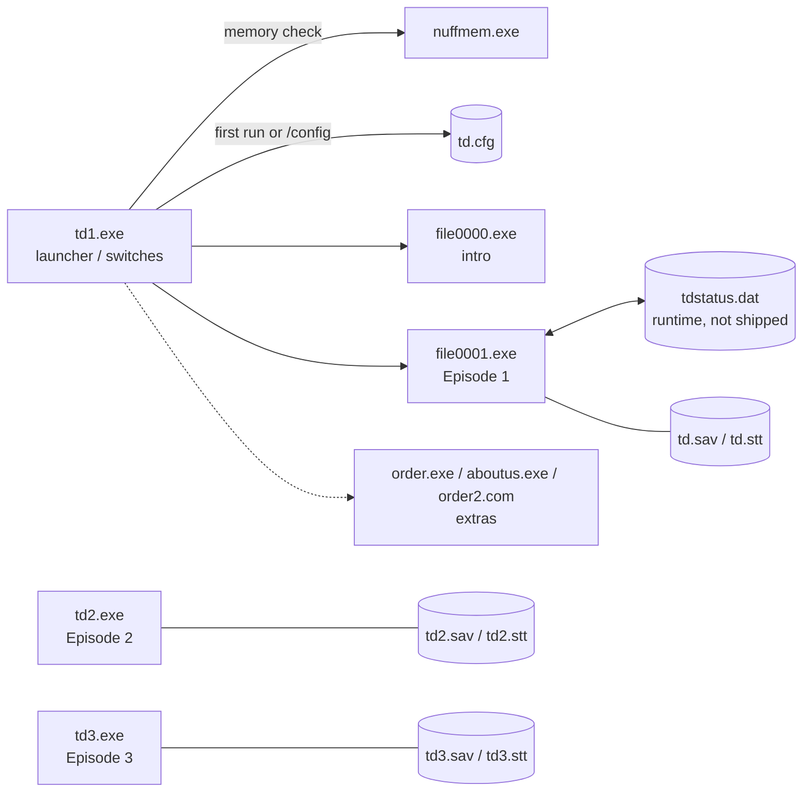
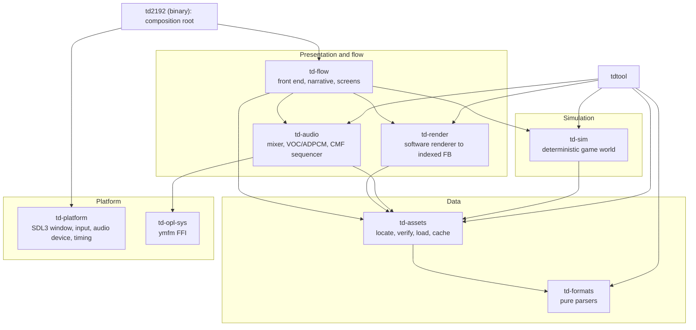
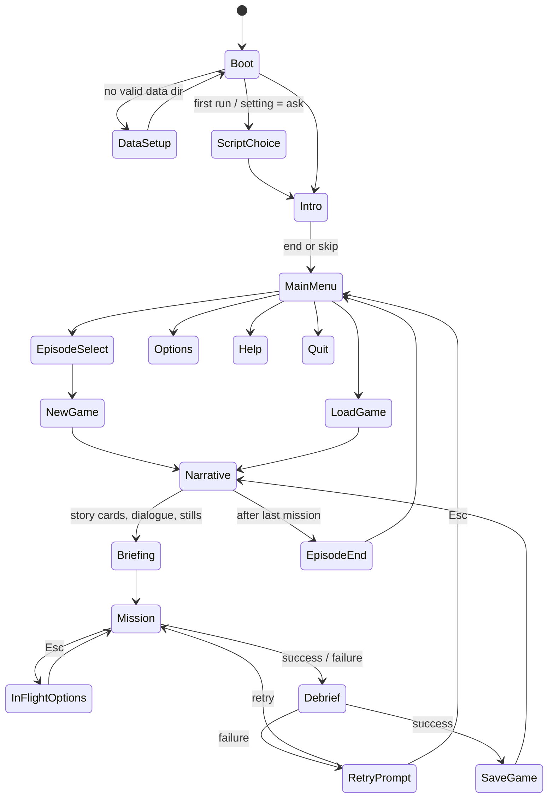
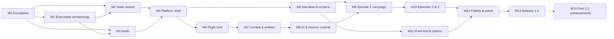

# TD2192-Modern: Master Design Guide

| | |
|---|---|
| **Document** | Master Design Guide (MDG) |
| **Version** | 0.1, 2026-11-02 |
| **Status** | Approved for implementation 2026-11-02 (D1 Rust + SDL3, D2 MIT decided); other decisions in §14 are pending |
| **Audience** | Every contributor, human or AI agent |
| **Companions** | [AGENT_DEVELOPMENT_GUIDE.md](AGENT_DEVELOPMENT_GUIDE.md) (how to work), [STATUS.md](STATUS.md) (who is doing what), [re/](re/) (reverse-engineering knowledge base), [spec/](spec/) (behaviour specifications), [adr/](adr/) (architecture decisions) |

This document says **what** we are building and **why**, how it is structured, and the order to build it in. The Agent Development Guide says **how** to do the work day to day. If the two documents conflict, this one wins on design and the Agent guide wins on process. Either way, fix the conflict in the same change.

Normative words: **MUST** / **MUST NOT** are hard requirements. **SHOULD** is the default unless a recorded reason says otherwise. **MAY** is optional.

---

## Table of contents

1. [Vision](#1-vision)
2. [Goals and non-goals](#2-goals-and-non-goals)
3. [Guiding principles](#3-guiding-principles)
4. [The original game](#4-the-original-game)
5. [Clean-room and legal model](#5-clean-room-and-legal-model)
6. [Fidelity model](#6-fidelity-model)
7. [Technology decisions](#7-technology-decisions)
8. [Architecture](#8-architecture)
9. [Subsystem designs](#9-subsystem-designs)
10. [Testing and verification strategy](#10-testing-and-verification-strategy)
11. [Quality, performance and accessibility targets](#11-quality-performance-and-accessibility-targets)
12. [Milestones](#12-milestones)
13. [Risk register](#13-risk-register)
14. [Open decisions](#14-open-decisions)
15. [Glossary](#15-glossary)
- [Appendix A: Campaign mission titles](#appendix-a-campaign-mission-titles)
- [Appendix B: In-game text anchors found so far](#appendix-b-in-game-text-anchors-found-so-far)
- [Appendix C: Document history](#appendix-c-document-history)

---

## 1. Vision

**TD2192-Modern** is a from-scratch, clean-room reimplementation of *Traffic Department 2192* (Safari Software / P² Productions, 1994; v1.0 files dated 1996-12-24). It runs natively on current Windows, Linux and macOS. It plays the player's own copy of the original data files and recreates the original experience faithfully: the top-down hoverskid combat over the city grid, the three-episode story of Lt. Marta Velasquez, the dialogue scenes, the OPL2 soundtrack and the digitised sound effects. It removes the DOS-era friction: memory managers, Sound Blaster IRQ settings, CPU-speed sensitivity, 320×200 windows the size of a postage stamp.

When it is finished, someone who played TD2192 in 1995 should be able to start the port, point it at their old game folder, and feel at home within ten seconds. Every mission plays out the way they remember, and it looks and sounds right on a 4K monitor with a modern gamepad.

## 2. Goals and non-goals

### 2.1 Goals

| ID | Goal |
|---|---|
| G1 | Play all three episodes (59-60 missions) from start to finish with the original story, dialogue, music and sound. |
| G2 | Reproduce gameplay behaviour (handling, combat, AI, mission logic, scoring) closely enough that original strategies and memorised routes still work. |
| G3 | Read every needed asset directly from an unmodified original installation that the user supplies. |
| G4 | Run on modern operating systems with modern input (keyboard remapping, gamepads), audio (no hardware configuration) and display (scaling, correct 4:3 aspect, fullscreen). |
| G5 | Be built cleanly: behaviour is reimplemented from written specifications, not transcribed from disassembly. |
| G6 | Be maintainable by AI agents and humans working in parallel: modular, well tested, thoroughly documented. |
| G7 | Offer an optional **Enhanced** profile with quality-of-life features, without compromising the **Classic** profile. |

### 2.2 Non-goals

| ID | Non-goal | Why |
|---|---|---|
| NG1 | Shipping or redistributing any original game file, or any file derived from one (renders, WAVs, extracted text). | Copyright. See §5. |
| NG2 | Emulating DOS, x86 or VGA hardware generally. | That is DOSBox's job. We reimplement the game, not the machine. |
| NG3 | Reproducing the launcher's memory checks, sound-card configuration, `nuffmem.exe`, `helpme.exe`, `catalog.exe`, the order forms or the shareware/BBS notices. | Obsolete. Their content goes into documentation where useful. |
| NG4 | Reproducing anything that modifies the host system (see the `label.exe` finding, §4.10). | Hostile behaviour. |
| NG5 | New story content, new missions or new art in 1.0. | Scope. Post-1.0 modding is §12 M14. |
| NG6 | Network multiplayer. | The original has none. |
| NG7 | Byte-compatible original save files as the primary save format. | We use our own versioned format; importing originals is optional (D3). |

## 3. Guiding principles

- **P1 Original data, original behaviour.** The user's original files are the single source of game content. Our code supplies behaviour; their files supply content.
- **P2 Specify, then implement.** Every non-trivial behaviour is first written down in `docs/spec/` with evidence and a confidence level. Code follows the spec. When the code and the spec disagree, one of them is wrong, and the fix must name which.
- **P3 Evidence over intuition.** "It feels right" is not acceptance. Acceptance is a reference capture, a decoded value, or a documented observation from the original running in DOSBox.
- **P4 Deterministic core.** The simulation is a pure function of (initial state, input stream). No wall clock, no unseeded randomness, no floating point in Classic gameplay logic, no iteration-order surprises.
- **P5 Layering is law.** Format parsing knows nothing of rendering. The simulation knows nothing of SDL. The platform layer knows nothing of missions. Dependency direction is enforced by crate boundaries (§8.2).
- **P6 Classic first, Enhanced second.** Enhanced features are switches layered on a correct Classic core, never forks of it.
- **P7 Small, verifiable steps.** Each task produces something testable. No large, unverifiable "big bang" integrations.
- **P8 Unknowns are first-class.** Anything we do not know goes in [re/UNKNOWNS.md](re/UNKNOWNS.md) with a plan to resolve it. Guesses in code are marked and tracked.
- **P9 Write it down.** Knowledge that lives only in an agent's context window is lost at the end of the session. Findings go in the docs in the same change that produced them.
- **P10 Respect the player's machine.** Never write to the original game directory. Store settings and saves in the standard per-user locations.

## 4. The original game

### 4.1 Overview

- **Title:** Traffic Department 2192 ("T.D. 2192"), version 1.0
- **Publisher:** Safari Software (Potomac, MD). Credited as "a P² production" (the Pallett-Plowright brothers).
- **Credits (from `file0000.exe`):** programming by John Pallett-Plowright, Robert A. Allen and Michael Pallett-Plowright. Graphics by Bruce Hsu, Michael Taylor and Samuel Goldstein. Storyline and dialogue by Christopher Perkins. The music credit name is in a separate string, still to be extracted.
- **Requirements (from `helpme.doc`):** 286 or faster, VGA, hard disk. Optional Sound Blaster / SB Pro / AdLib, PC speaker, Gravis PC GamePad / joystick. At least 560 KB of free conventional memory.
- **Setting:** The year 2192 on the desert planet **Seche**. The hoverskid, a cheap, fast floating vehicle, is the universal transport. The **Vulture** cult-army has waged a 25-year terror campaign. The **Traffic Department (T.D.)**, created to regulate hoverskid traffic, has become the people's army.
- **Protagonist:** Lt. **Marta "Vel" Velasquez**, T.D. pilot, born in Vulthaven. Her father, **Ric Velasquez**, was killed by ion cannon fire in front of her (the intro, dated May 16, 2178).
- **Structure:** Three episodes. Each is a separate DOS program with its own city map, tileset, portraits, dialogue file and save set.
  - **Episode 1:** **Vulthaven**, 20 missions, `file0001.exe`, ending "continued in episode 2...".
  - **Episode 2:** **Vultigard**, 20 missions, `td2.exe`.
  - **Episode 3:** 2193; **Kolor**, mining stations and orbit; `td3.exe`. Mission files `m1..m19.td3` plus `m21.td3` (see U-012).
- **Content warning feature:** an uncut script (`dialogue.dat` etc.) and an edited one (`safedial.dat` etc.). The game asks which to use. If `dialogue.dat` is missing it falls back to the edited script and shows a notice.

### 4.2 Gameplay as known so far

The following comes from in-game text in the executables (Appendix B) and from the decoded assets. Every item here MUST be confirmed and detailed by a spec before it is implemented.

- **View:** Top-down, scrolling over a 201×201 grid of 32×32-pixel tiles (a 6432×6432-pixel city), rendered in VGA mode 13h (320×200, 256 colours).
- **Craft:** hoverskids drawn as 32×32 sprites with pre-rotated variants, apparently 16 headings (§9.3.5).
- **Ship classes** (stat strings in `file0001.exe`):

  | Class | Armament | Armour | Shields | Top speed |
  |---|---|---:|---:|---|
  | Truck | none | 3200 | 0 | 76 mph |
  | Transport | (not given) | 2400 | 0 | 115 mph |
  | Vulture I | 2 medium-power ion cannons | 2500 | 2500 | 118 mph |
  | Vulture II | 4 light ion pulsers | 2000 | 2500 | 185 mph |
  | Stiletto | 4 cannons + afterburners | 1500 | 1800 | 316 mph |
  | Stingray | 2 light ion pulsers | ? | ? | 125 mph |
  | Hornet | 2 medium-power cannons, "standard missile fittings" | ? | ? | 120 mph |

  More classes appear later: Vulture VI and VII, mercenaries, helicopters (`td.hel`, `helihang.scr`), the Javelin (`javelin.td`, E2M11), a lander (`lander.td`), mines (`mine.td`).
- **Guidance line:** circles the player's ship and points at the current target. Red means destroy it, green means protect it, blue means go to that location.
- **Afterburner:** `Ins` or keypad `+`, or joystick button 2. Short bursts of very high speed.
- **Infra-red:** `Alt` toggles it ("hit -alt- to activate infra red"). Some missions require it.
- **Communications:** "incoming communication", viewed with `F6`; "end transmission... hit f6".
- **Ship switching:** `Tab` changes ships in some missions ("go to the v.c.i., start the detonator, then switch ships").
- **Options:** `Esc` in flight opens the gameplay options, including Help.
- **Pause:** "paused -- hit any key to continue".
- **Jurisdiction:** leaving the city triggers warnings ("do not leave your jurisdiction, velasquez").
- **Objectives:** shown as one-line messages, e.g. "destroy the two trucks heading for the south entrance".
- **Debriefing:** mission successful or incomplete, kills this mission, kills to date, and a rating comment from about 12 tiers (from "needs experience" to "true genius in a skid"). There is also a cheat-detection tier: "velasquez is a cheater! you should be ashamed!".
- **Failure:** six or more taunting retry prompts; retry with `y` or any key, or `Esc` to return to the main menu.
- **Personnel files ("dossiers"):** name, place and date of birth, rank, status (alive/dead), station, kills, known T.D. kills, comments.
- **Saves:** 10 named slots per episode ("--- empty game ---", "game name", "mission").
- **Narrative between missions:** title cards ("mission iv - fly by night"), location and time cards ("commander satair's office", "25 radians later"; *radians* is the in-universe time unit), dialogue scenes with portraits over full-screen backdrops, and story stills (`td1-13.pic`..`td1-20.pic`).

### 4.3 Original controls (known so far)

| Action | Original binding |
|---|---|
| Fly / turn | Keyboard (bindings to be confirmed in M1) or joystick / Gravis GamePad |
| Fire | To be confirmed (likely `Ctrl` / `Space` / joystick button 1) |
| Afterburner | `Ins`, keypad `+`, joystick button 2 |
| Infra-red toggle | `Alt` |
| View communication | `F6` |
| Change ship | `Tab` |
| Options / help / back | `Esc` |
| Pause | To be confirmed |
| Dialogue: next page / skip | `Space` / `Esc` ("hit space to scroll through the dialogue, or hit esc to get to the action") |
| Script choice | `1` uncut / `2` edited |

### 4.4 Technical profile of the original

| Aspect | Finding | Confidence |
|---|---|---|
| Language / compiler | Borland Pascal 7.0 ("Portions Copyright (c) 1983,92 Borland"), 16-bit real mode MZ executables | CONFIRMED |
| Sound library | WORX Toolkit 2.1 (© 1993 Mystic Software): VOC and CMF playback on SB/AdLib, PC speaker | CONFIRMED (string) |
| Video | VGA mode 13h, 320×200×8bpp, 6-bit DAC palettes | CONFIRMED (asset formats) |
| Packing | Game executables are **not** packed (relocation tables intact, strings in plain text). Only `catalog.exe` is LZEXE-packed. | CONFIRMED |
| Overlays | None (MZ image size equals file size for every game exe) | CONFIRMED |
| Strings | Pascal ShortStrings (length byte prefix). Game text is all lowercase. A double quote `"` stands in for the apostrophe (`velasquez"s`). | CONFIRMED |
| Engine sharing | `file0001.exe`, `td2.exe` and `td3.exe` are separate builds of what appears to be a shared engine, with per-episode content and logic | LIKELY |
| Timing model | **Unknown.** It could be VGA-retrace locked (70.086 Hz), PIT-driven, or CPU-bound. | UNKNOWN (U-001) |

Executable details, MZ header facts and string anchors are in [re/EXECUTABLES.md](re/EXECUTABLES.md).

### 4.5 Original process architecture



How Episodes 2 and 3 are started in the original (directly, or chained from a menu) is U-005. The port replaces the whole chain with a single executable and an episode-select front end.

### 4.6 Data file summary

The full inventory with SHA-256 for all 218 files is in [re/FILE_INVENTORY.md](re/FILE_INVENTORY.md). Detailed format notes are in [re/FORMATS.md](re/FORMATS.md).

| Category | Files | Format status |
|---|---|---|
| Full-screen scenes | 44 × `.scr`, `city.td`, `javelin.td` | **Decoded:** 768-byte 6-bit palette + 320×200 linear |
| Palettes | `td.pal`, `tdmen.pal` | **Decoded:** 256 × RGB, 0..63 |
| Tilesets | `td.blk`, `td2.blk`, `td3.blk` | **Decoded** (E1): 80 × 32×32. E2/E3 have 864 extra trailing bytes |
| Maps | `td.map`, `td2.map`, `td3.map`, `td4.map`, `intro.map` | **Decoded** (E1): 201×201 bytes. Intro map is 200×200 |
| Sprites | `td.shp`, `td.sc3`, `td.shr`, `td.sc2`, `mine.td`, `lander.td`, `td.exp`, `td.hel`, `td.h2` | **Partly decoded:** base 32×32 set and 40×40 rotation sets |
| Missions | 20 × `.td`, 20 × `.td2`, 20 × `.td3` (20080 bytes each) | **Structure hypothesis:** 80-byte header + 20 X paths + 20 Y paths of 500 steps |
| Dialogue | `dialogue.dat`, `dialogu2.dat`, `dialogu3.dat`, `safedial.dat`, `safedia2.dat`, `safedia3.dat` | **Partly decoded:** control-byte line script |
| Portraits | `newfaces.td`, `.td2`, `.td3` | Palette + face cells; geometry TBD |
| Story stills | `td1-13.pic`..`td1-20.pic`, `secret.pic`, `pic4.td` | Palette + unknown (compressed or sub-rect) |
| UI graphics | `td.men`, `td.hlp`, `td.win`, `td.cmm`, `td.sel`, `td.sss`, `td.wea`, `td.fac`, `td.dun`, `td.joy`, `td1/2/3.ccm` | Raw 8bpp; dimensions to recover from code |
| Fonts | `td.lt2`, `td.ltr`, `td-let.cin` | Bitmap; glyph layout TBD |
| Music | 17 × `.cmf` | **Standard** Creative Music File v1.01 (OPL2) |
| Sound effects | 17 × `.voc` | **Standard** Creative Voice File; mostly Creative ADPCM (4, 2.6 and 2-bit) |
| Saves / config | `td.cfg`, `td*.sav`, `td*.stt` | Partly decoded |
| Extras | `*.tfp`, `aboutus/order/catalog/helpme/nuffmem.exe`, `*.doc` | Out of scope except as documentation sources |

### 4.7 Quirks discovered so far

1. **DOS 8.3 truncation is load-bearing.** The code asks for `helihangar.scr`, and DOS opens `helihang.scr`. The asset locator MUST resolve names by truncating base names to 8 characters and extensions to 3, case-insensitively.
2. **Map width is 201**, not 200 (the intro map is 200). Off-by-one sizes are probably intentional (inclusive 0..200 coordinates).
3. **Text uses `"` as an apostrophe** and is all lowercase. The font decides how these glyphs look.
4. **Objective strings are fixed-width** (about 80 characters, space-padded, Pascal length byte).
5. **Most VOCs are ADPCM**, which the SB DSP decoded in hardware. The port needs software decoders for all three Creative ADPCM variants.
6. **Executable-embedded content:** mission titles, story cards, objective text, ship stat text, debrief comments, the intro story and the credits all live inside the executables, not in data files (§5.3, §9.1.4).
7. **Host-modifying behaviour:** `file0001.exe` contains `c:\dos\label.exe`, `label.exe`, `velasquez` and `PLAY TD2192` next to the in-flight UI strings. This is probably a prank or anti-piracy path that relabels the user's disk. It is documented for completeness and MUST NOT be reproduced (NG4).
8. `tdstatus.dat` is referenced but not shipped. It is runtime state passed between processes (U-004).

## 5. Clean-room and legal model

> This is an engineering policy, not legal advice. The project owner should take advice before any public release.

### 5.1 Two-hat process

We separate **knowing how the original works** from **writing our code**:

| Hat | Reads | Writes |
|---|---|---|
| **Archaeologist** (reverse engineering) | Original binaries, Ghidra, DOSBox debugger, decompiler output | Findings in `docs/re/`, symbol CSVs, Ghidra scripts. Never production code. |
| **Spec author** | Archaeologist findings, captures | Behaviour specs in `docs/spec/`: prose, tables, constants, original pseudocode in our own words and structure |
| **Implementer** | Specs, format docs, this guide, the repo | Production code and tests. **Does not read decompiler output or disassembly.** |
| **Verifier** | Running port, running original (DOSBox), captures | Test cases, parity reports, bug reports |

An agent session wears one hat per task. The task brief MUST state the hat. Moving from Archaeologist to Implementer on the *same subsystem* in the *same session* is not allowed. Start a fresh session (fresh context) with only the spec as input.

### 5.2 What may enter the repository

- Our own source code, tests, tools and documentation.
- **Facts** about the original: file sizes, SHA-256 hashes, offsets, structure layouts, numeric constants (speeds, armour values, timings), enumerations, table *layouts*, algorithm *descriptions* in our own words.
- Short identifying excerpts in documentation where needed to locate something (for example a mission title used as an anchor). Keep them to a minimum.
- Symbol and annotation CSVs (our names for original addresses).
- Third-party code with licences compatible with the project licence (§5.4).

### 5.3 What MUST NOT enter the repository

- Any original game file, in whole or in part, or any re-encoding of one (PNG, WAV, JSON dumps of text, extracted strings).
- Bulk game text: dialogue, story cards, objective text, credits. These are loaded **at runtime** from the user's files (§9.1.4).
- Decompiler output, disassembly listings, or code transliterated from either.
- Ghidra project databases (binary, and they embed the original program bytes).
- DOSBox captures of the original (screenshots, audio, video). These live in the RE work area outside the repo.
- Code copied from GPL-licensed emulators (DOSBox, etc.) unless the project licence is GPL-compatible *and* the decision is recorded in an ADR.

### 5.4 Third-party components

Only permissive licences (MIT, BSD, Apache-2.0, Zlib, ISC) unless D2 picks a copyleft project licence. The planned dependencies are in §7.1. Any new dependency needs a line in `THIRD_PARTY.md` (created in M0) with its licence.

### 5.5 Asset model: bring your own data

The port ships **no** game content. On first run the user points it at an original installation (directory, or later the original ZIP; see M13). The asset system verifies files against the SHA-256 manifest and reports which episodes are playable. Tests that need data are skipped automatically when no data directory is configured (§10.3).

## 6. Fidelity model

### 6.1 Fidelity tiers

Every subsystem spec MUST state its target tier:

| Tier | Meaning | Typical subsystems |
|---|---|---|
| **T0 bit-exact** | Byte-for-byte or pixel-for-pixel identical output for the same input | Format decoding, static screen composition, palette values, text layout |
| **T1 behaviour-exact** | Same state evolution tick by tick for the same inputs, within integer rounding of the original | Physics, collision, weapons, AI decisions, mission logic, RNG sequences, scoring |
| **T2 perceptually equivalent** | A human A/B test cannot reliably tell them apart | OPL synthesis, ADPCM resampling, fades, frame pacing on non-70 Hz displays |
| **T3 intentional deviation** | Documented, justified difference | Enhanced features, removed hostile behaviour, crash-bug fixes |

The default target is T1 for gameplay and T0 for presentation. Falling back to a lower tier needs a written justification in the spec.

### 6.2 Profiles

- **Classic** (default): original resolution and aspect, original timing, original controls (remappable), original audio behaviour including monophonic SFX preemption if that is what the original does, original rules.
- **Enhanced** (opt-in, per feature): polyphonic SFX, quick-save, skippable intro, colour-blind-safe guidance line palette, widescreen viewport (M14), hold/toggle afterburner, and so on. Each Enhanced feature is a separate setting that defaults to off and has its own entry in the settings spec.

Gameplay-affecting Enhanced features (widescreen, quick-save) are marked as such in the UI.

### 6.3 Bug policy

Original bugs are recorded in `docs/spec/original-bugs.md`. Each one gets a decision:

- **Preserve** when it affects gameplay, strategy, or the feel that players remember (for example an exploitable collision gap).
- **Fix in all profiles** when it crashes, hangs, corrupts saves or blocks progress.
- **Fix in Enhanced only** when it is a pure annoyance.

### 6.4 Reference oracle

The original game running in DOSBox, from a **writable copy** of the installation (never the pristine folder), is the reference. Reference captures (screenshots, audio, input-synchronised recordings, memory dumps) are stored in the RE work area (`P:\msdos\TD2192\re-work\captures\`) with a manifest. The procedures are in Agent Guide §10.

## 7. Technology decisions

### 7.1 Stack (ADR-0001)

| Concern | Choice | Notes |
|---|---|---|
| Language | **Rust** (stable, edition 2024, toolchain pinned in `rust-toolchain.toml`) | Memory safety, built-in test/bench/fmt/lint, strong typing for binary formats, explicit integer-width semantics, easy multi-crate layering. Installed: rustup stable MSVC host. |
| Platform layer | **SDL3** via the `sdl3` crate | Window, GPU texture presentation, keyboard, gamepad, audio stream, file dialogs. Cross-platform. |
| OPL2 emulation | **ymfm** (BSD-3-Clause, C++) wrapped in a small `td-opl-sys` crate built with `cc` | Accurate, permissively licensed. ADR-0005. |
| ADPCM / VOC / CMF | Our own Rust code from public format descriptions | Small and well documented. |
| Error handling | `thiserror` (libraries), `anyhow` (binaries) | |
| Logging | `tracing` + `tracing-subscriber` | |
| CLI | `clap` | `tdtool` and dev flags |
| Config / saves | `serde` + `toml` (settings), `serde` + versioned binary or RON (saves) | |
| Hashing | `sha2` | Asset manifest, golden tests |
| Image / audio export (tools and tests only) | `png`, `hound` | Never used to commit assets |
| Testing | built-in `cargo test`, `insta` (snapshots of *our* textual outputs), `proptest`, optional `cargo-fuzz` (Linux CI) | |
| Build | Cargo workspace. MSVC toolchain on Windows (Visual Studio 2026 Community is installed). CMake only if SDL3 is built from source. | |
| CI | GitHub Actions: Windows, Linux, macOS | |
| RE tooling | Ghidra 12.2 (`C:\Users\jason\Desktop\ghidra_12.2_PUBLIC`, JDK 25 at `C:\Program Files\Eclipse Adoptium\jdk-25.0.5.8-hotspot`); a local debug-enabled DOSBox-X built from the source at `P:\msdos\TD2192\dosbox-x` (GPL: a tool only, never a source of code for the port); Python 3.10 + Pillow for throwaway analysis | Outside the repo, except our own scripts |

### 7.2 Architecture decision records

| ADR | Title | Status |
|---|---|---|
| [0001](adr/0001-language-and-platform.md) | Rust + SDL3 | Accepted |
| [0002](adr/0002-clean-room-protocol.md) | Two-hat clean-room protocol | Accepted |
| [0003](adr/0003-bring-your-own-data.md) | Bring-your-own-data; runtime extraction of executable-embedded content | Accepted |
| [0004](adr/0004-indexed-framebuffer-and-fixed-timestep.md) | 320×200 indexed framebuffer and deterministic fixed-timestep simulation | Accepted |
| [0005](adr/0005-opl-emulation.md) | OPL2 emulation via ymfm | Accepted |

New decisions get the next number. Superseded ADRs are kept and marked as superseded.

### 7.3 Platforms

- **Tier 1:** Windows 10/11 x64 (primary development platform).
- **Tier 2:** Linux x64 (Ubuntu LTS, Steam Deck), macOS (Apple Silicon and Intel).
- CI builds and unit tests run on all of them. Data-gated tests run locally.

## 8. Architecture

### 8.1 Layers



### 8.2 Workspace crates and dependency rules

| Crate | Responsibility | May depend on | MUST NOT depend on |
|---|---|---|---|
| `td-formats` | Pure `&[u8]` → typed structures for every original format. No I/O, no allocation surprises, no panics on bad input. | `thiserror` | everything else |
| `td-assets` | Find the data directory, resolve 8.3/case-insensitive names, verify the manifest, load and cache, extract exe-embedded resources by offset map, episode availability | `td-formats`, `sha2` | render, audio, sim, platform |
| `td-sim` | Deterministic world: entities, physics, collision, weapons, AI, missions, scoring, RNG. Integer and fixed-point math only. Emits events (sounds, music cues, messages). | `td-assets` (read-only data types), `td-formats` types | render, audio, platform, flow |
| `td-render` | Draws into `Framebuffer { pixels: [u8; 64000], palette: [Rgb6; 256] }`: tiles, sprites, text, HUD, effects, fades | `td-assets`, `td-sim` (read-only view of state) | platform, audio |
| `td-audio` | Sample mixer, VOC/ADPCM decode, CMF sequencer, OPL bridge, PC-speaker synthesis (later). Produces PCM frames. No device I/O. | `td-assets`, `td-opl-sys` | platform, render, sim |
| `td-opl-sys` | FFI wrapper over ymfm's OPL/OPL2 core. The only `unsafe` outside the platform crate. | `cc` (build) | everything else |
| `td-flow` | Top-level state machine: launcher/config equivalent, intro, menus, story cards, dialogue scenes, briefings, debriefings, save/load UI, episode progression; owns the `Sim` during missions | sim, render, audio, assets | platform |
| `td-platform` | SDL3: window, presentation and scaling, input devices to an action snapshot, audio device, clock, filesystem locations, file dialog | `sdl3`, `td-render` types (framebuffer) | sim, flow internals |
| `td2192` (bin) | Wires platform and flow together; CLI flags; settings | all runtime crates | |
| `tdtool` (bin) | Developer CLI: inventory, export, dump, render-scene, play, replay-verify, diff | all crates | |
| `td-test-support` (dev) | Data-dir discovery for tests, `require_data!`, golden-hash helpers, synthetic fixtures | formats, assets | |

Rules:
1. Dependency direction is strictly downward in the diagram. A crate that needs something "upward" receives it through a trait or an event.
2. `#![forbid(unsafe_code)]` in every crate except `td-platform` and `td-opl-sys`.
3. `td-sim` and `td-formats` MUST compile and test without SDL, audio devices or data files.
4. No global mutable state. Pass contexts explicitly.

### 8.3 Repository layout

```
TD2192-Modern/
├── AGENTS.md                 # always-on rules for AI agents (short)
├── CLAUDE.md                 # imports AGENTS.md for Claude Code
├── README.md
├── THIRD_PARTY.md            # (M0) dependency licences
├── Cargo.toml                # (M0) workspace
├── rust-toolchain.toml       # (M0)
├── crates/                   # (M0) the crates in §8.2
├── tools/
│   ├── ghidra/               # our Ghidra scripts (Java/Python) — no Ghidra DBs
│   └── scripts/              # our helper scripts (PowerShell/Python)
├── docs/
│   ├── MASTER_DESIGN_GUIDE.md
│   ├── AGENT_DEVELOPMENT_GUIDE.md
│   ├── STATUS.md
│   ├── adr/
│   ├── re/                   # RE knowledge base: inventory, formats, executables, unknowns, symbols/*.csv
│   └── spec/                 # behaviour specs, organised by subsystem
└── .github/workflows/        # (M0) CI
```

Outside the repo (never committed):

```
P:\msdos\TD2192\
├── TD2192\                  # pristine original install: READ-ONLY by policy
├── TD2192-Modern\           # this repository
└── re-work\                 # RE work area (created in M0)
    ├── ghidra\              # Ghidra project (TD2192.gpr)
    ├── exports\             # decompiler/disassembly exports (Archaeologist eyes only)
    ├── dosbox\              # DOSBox config + writable game copy (C:\TD)
    ├── captures\            # reference screenshots / audio / video / memory dumps + MANIFEST.md
    └── scratch\             # throwaway analysis
```

### 8.4 Runtime loop

ADR-0004 fixes a **fixed-timestep simulation** whose tick rate is the original's (to be established in M1-06, U-001). Rendering and presentation are decoupled from it:

```
loop {
    platform.pump_events() → InputSnapshot (actions, edges, analog)
    accumulator += real_elapsed (clamped to avoid spiral of death)
    while accumulator >= TICK {
        flow.tick(input_for_this_tick)   // advances sim / screen state exactly one original tick
        accumulator -= TICK
    }
    flow.draw(&mut framebuffer)          // indexed 320×200 + palette
    platform.present(&framebuffer)       // palette LUT → RGBA → scaled texture
    audio is pulled by the device callback from td-audio's ring buffer
}
```

- Classic profile: no interpolation. The latest completed tick is presented. On a 60 Hz display with a 70 Hz tick rate, some ticks are never shown, which is acceptable (T2) and consistent with how emulators behave.
- Input is sampled per tick with **edge detection** (pressed-this-tick) handled in the flow layer. That reproduces the original's "hit any key" semantics.
- If the original turns out to be frame-locked with variable work per frame (U-001), the spec defines the canonical tick, and this loop stays the same.

### 8.5 Top-level flow (port)



The exact original order (where saving happens, whether debrief precedes dialogue, how an episode ends) MUST be confirmed in M1-04 and M9. This diagram is a starting hypothesis.

### 8.6 Determinism contract (td-sim)

1. The state is a plain data structure, `Clone + PartialEq + Debug`, with a stable serialisation used for hashing.
2. `Sim::tick(&mut self, input: &TickInput) -> TickEvents` is the only way time advances.
3. Randomness comes only from `BpRandom`, a reimplementation of the Borland Pascal 7 `Random` generator (linear congruential; the multiplier, increment and output-scaling details are to be confirmed in M1-01), seeded exactly as the original seeds it.
4. No `HashMap` or `HashSet` iteration in the simulation (use `Vec`, `BTreeMap`, or index-based arenas). No floating point in Classic gameplay paths. No wall-clock reads.
5. Integer widths mirror the original where behaviour depends on them (`i16`/`u16` with explicit wrapping where the original wraps). `overflow-checks = true` in every profile for `td-sim` so that unintended overflow fails loudly.
6. `state_hash()` after every tick feeds replay tests (§10.2 L4).

### 8.7 Errors, logging, diagnostics

- Libraries return typed errors (`thiserror`). Parsers never panic on malformed input; this is fuzz-tested.
- The binary uses `anyhow` with context. Fatal errors show a friendly dialog (SDL message box) with the log path.
- Logging uses `tracing` with per-crate targets. The default level is `info` in release and `debug` in dev. `--log <filter>` overrides it.
- Dev builds get an overlay (F-keys behind a `dev` feature): FPS, tick rate, entity count, player state, AI path display, collision display, mission trigger state.

### 8.8 Configuration and paths

- The settings file is `settings.toml` in the platform config directory (Windows `%APPDATA%\TD2192-Modern\`, Linux `$XDG_CONFIG_HOME/td2192-modern/`, macOS `~/Library/Application Support/TD2192-Modern/`).
- Saves go in `saves/` under the platform data directory.
- Data directory precedence: `--data <path>` CLI > `TD2192_DATA` env var > `settings.toml` > first-run picker.
- The original directory is opened **read-only**. The port never writes `td.cfg`, `*.sav`, `*.stt` or `tdstatus.dat` there.

## 9. Subsystem designs

Each subsection below is the design *intent*. Detailed behaviour belongs in the matching spec file under `docs/spec/<area>/`. File names are listed per subsection.

### 9.1 Asset system (`td-assets`)

**9.1.1 Locator.** It resolves logical names (as the original code spells them, for example `helihangar.scr`) to files:
1. Lowercase.
2. Truncate the base name to 8 characters and the extension to 3 (DOS 8.3).
3. Match case-insensitively against a directory listing taken once at start-up.

**9.1.2 Manifest and validation.** The manifest is generated from `docs/re/FILE_INVENTORY.md` into `crates/td-assets/src/manifest.rs` by `tdtool gen-manifest` and committed. It lists name, size, SHA-256, category and the episodes that need the file. Validation reports OK, missing, modified (hash mismatch) and extra files, then works out which episodes are playable. Modified files are a warning, not an error: some users will have patched or alternative releases. Behaviour on unknown versions is §14 D10.

**9.1.3 Episode data sets.** `EpisodeData { tileset, map(s), portraits, dialogue{uncut,edited}, comm_gfx, missions[..], saves... }` is built per episode from a declarative table (episode → filenames). Which files each episode uses is confirmed in M1-05.

**9.1.4 Executable resource map (ADR-0003).** Text and tables embedded in the original executables are read **at runtime** from the user's copies:
- `docs/re/exe-resources/<exe>.toml` (committed) lists the expected exe SHA-256 and the resources: `{ id, kind = pstring | pstring_array | fixed_width_text | u8_table | i16_table, offset, count, width }`.
- `td-assets` checks the exe hash and then extracts by offset. A wrong hash means the resource is unavailable, and the game shows a clear message.
- Numeric gameplay constants (speeds, armour and so on) MAY be committed as Rust constants with a citation comment (they are facts), but SHOULD also be cross-checked against runtime extraction in a data-gated test.

**9.1.5 Caching.** Decoded assets are immutable `Arc<T>` held in a cache keyed by logical name. Everything is small (9 MB total), so the whole set can be loaded eagerly at start-up.

Specs: `spec/assets/locator.md`, `spec/assets/exe-resources.md`.

### 9.2 Format layer (`td-formats`)

One module per format. Each one exposes:
- `parse(bytes: &[u8]) -> Result<T, FormatError>`. Total: it never panics, and bounds are checked.
- Where useful, `encode(&T) -> Vec<u8>` for round-trip tests (no shipping use).
- Plain data types with documented units.

Planned modules: `palette`, `screen` (palette + 320×200), `tileset`, `map`, `sprite_sheet` (32×32 base set), `rotation_set` (40×40 cells), `picture` (`.pic`), `portraits`, `font`, `ui_raw` (sized raw bitmaps), `mission`, `dialogue`, `save` (`.sav`/`.stt`), `config` (`td.cfg`), `voc`, `cmf`, `tfp` (optional), `mz` (minimal MZ header reader for exe-resource extraction), `pstring`.

Format knowledge lives in [re/FORMATS.md](re/FORMATS.md). The module doc comments summarise it and link back to it.

### 9.3 Graphics (`td-render`)

**9.3.1 Framebuffer.** `Framebuffer { pixels: Box<[u8; 320*200]>, palette: [Rgb6; 256] }`. All game drawing targets this. It is the T0 surface: tests hash it.

**9.3.2 Palette.** VGA 6-bit components. Conversion to 8-bit uses `(v << 2) | (v >> 4)`, the standard bit replication, so 63 maps to 255. Palette effects (fade to and from black, flashes, infra-red remap) operate on the 6-bit palette exactly as the original writes the DAC (rates from RE). `td.pal` is the flight palette, `tdmen.pal` the menu palette, and every scene file carries its own.

**9.3.3 Full screens.** Copy the 64000 bytes and load the palette. Used for scene backdrops, title screens and help.

**9.3.4 Tile map renderer.** It draws the visible window of the 201×201 map from the 80-tile set at the camera position. The viewport size and position on screen (the HUD takes part of the screen) come from RE (M1-03, M6). Tiles have no transparency. Out-of-range tile indices are an error in debug builds and draw tile 0 in release.

**9.3.5 Sprites and rotation.**
- Base set: `td.shp` = 20 frames of 32×32, nose up. Rotation sets: `td.sc3`, `td.shr` and `td.sc2` = 24 cells of 40×40 each (20 used), pre-rotated by roughly 22.5°, 45° and 67.5°.
- Hypothesis (to confirm in M2): heading `h ∈ 0..16`; base = `[shp, sc3, shr, sc2][h % 4]`; then rotate by `90° × (h / 4)` using exact pixel transposition and flips. No resampling, so it stays T0.
- Colour index 0 is transparent (confirm).
- Effect frames (explosions, projectiles) are in slots 10..19 of the base set. Mapping from slot to meaning is confirmed in M2/M7.
- Draw order (ground objects, then ships, then projectiles, then effects, then HUD) is confirmed in M6/M7.

**9.3.6 Text.** Three fonts (`td.lt2`, `td.ltr`, `td-let.cin`). Glyph geometry, the character map (lowercase-only, the `"` glyph), colours (dialogue uses a per-speaker palette index), spacing and wrapping all come from M2/M5 RE. Text drawing is T0: snapshot tests compare framebuffer hashes.

**9.3.7 HUD.** Elements known so far: guidance line circle and target pointer, objective message line, comm indicator, ship-status panel (class, registry, pilot), armour and shields, speed, IR state, and kills (?). Layout comes from RE (M6-07) and captures.

**9.3.8 Presentation (`td-platform`).**
- Palette LUT: the indexed framebuffer becomes RGBA8 on the CPU (64000 pixels, trivial), uploaded to a streaming texture.
- Scaling modes: **Aspect-correct 4:3** (default; pixel aspect 5:6, so each source pixel is 1.2× taller than wide), **integer square pixels**, **stretch**. Aspect-correct uses sharp-bilinear: nearest-neighbour up to the largest integer factor, then linear for the remaining fraction. Letterboxing is black.
- An optional CRT/scanline shader is Enhanced, M14.
- Screenshot (`F12`) saves the *framebuffer* (indexed → PNG) to the user's screenshot directory, never to the repo.

Specs: `spec/render/*.md` (palette, screens, tiles, sprites, text, hud, effects, presentation).

### 9.4 Audio (`td-audio`)

**9.4.1 Pipeline.** The sim and flow emit `AudioCommand`s (PlayMusic(id, loop), StopMusic, PlaySfx(id, priority), StopSfx, SetVolumes). `td-audio` runs a mixer that produces 48 kHz stereo `f32`. `td-platform` pulls frames through an SDL3 audio stream. Audio has no access to sim state. It only sees commands.

**9.4.2 VOC.** Parse the Creative Voice File (header `Creative Voice File\x1A`; block types 0 terminator, 1 sound data, 2 continuation, 3 silence, 4 marker, 5 text, 6/7 repeat, 8 extended, 9 new-format data). Codecs in our files: 0 = 8-bit unsigned PCM, 1 = 4-bit Creative ADPCM, 2 = 2.6-bit (3-bit) Creative ADPCM, 3 = 2-bit Creative ADPCM. Sample rate = `1_000_000 / (256 − time_constant)`. Decoders are written from public descriptions of the SB ADPCM schemes and checked against DOSBox captures (T2). Resample to 48 kHz with a good band-limited resampler. Optionally add a "classic" mode with SB-like zero-order hold and low-pass filtering.

**9.4.3 SFX policy.** The original targets SB 1.x/2.0-class hardware, which plays **one** digital stream at a time, so new effects probably preempt old ones by priority. Classic mode reproduces the original policy as established by RE of the WORX call sites (M1-02, M3-06). Enhanced mode allows N simultaneous voices.

**9.4.4 CMF music.** Parse CMF v1.01 (`CTMF` header: instrument and music offsets, timing fields, 16 channel-in-use flags, instrument count; 16-byte OPL instrument records; MIDI-like event stream). The sequencer handles note on/off, program change, controller events including CMF-specific ones (0x63 AM/VIB depth, 0x66 marker, 0x67 rhythm mode, 0x68/0x69 transpose), running status, end of track and looping. It drives OPL2 registers through `td-opl-sys`.

Timing: header field @0x0A varies per song (23..192) and @0x0C is 96 in every file. **Which one WORX uses, and whether it overrides tempo, MUST be established (U-007)** before music is accepted.

Music cue mapping (which song plays for which screen, mission or event) comes from RE (M1-02) and lives in `spec/audio/music-cues.md`.

**9.4.5 PC speaker and AdLib-only modes.** Low priority (M12). The PC speaker SFX are synthesised square-wave sequences defined in the exe (to be RE'd). They are only needed if we want an "authentic PC speaker" option.

**9.4.6 OPL output** is rendered at the OPL native rate (about 49716 Hz) and resampled to the device rate. Volume balance between music and SFX should match the original mix measured from captures (T2).

Specs: `spec/audio/{voc,adpcm,cmf,sequencer,mixer,sfx-policy,music-cues}.md`.

### 9.5 Input

- `td-platform` produces an `InputSnapshot` per frame: the state of every **action** plus raw key state, for "any key" prompts and text entry.
- Actions (initial set): `TurnLeft`, `TurnRight`, `Thrust`, `Brake/Reverse` (to be confirmed), `Fire`, `FireSecondary`/missile (to be confirmed), `Afterburner`, `InfraRed`, `ViewComm`, `SwitchShip`, `Pause`, `Menu/Back`, `Confirm`, `DialogueNext`, `DialogueSkip`.
- Default bindings reproduce the original keys exactly, including `Alt` for infra-red, `Ins`/keypad `+` for afterburner, `F6`, `Tab` and `Esc`. **Pitfall:** do not use `Alt+Enter` for fullscreen, because `Alt` is a game key. Use `F11`.
- Gamepad: SDL3 gamepad mapping with sensible defaults. Analog-stick turning in Classic quantises to the original's digital turn semantics unless an Enhanced analog option is enabled.
- The original joystick calibration screen ("swirl the joystick and hit a button...") is replaced by modern device handling.
- Text entry (save names) uses SDL text input, restricted to the original's character set and length (24 characters, to be confirmed).

Spec: `spec/input/actions-and-bindings.md`.

### 9.6 Simulation (`td-sim`)

All of this is to be established by RE. The structure below is the design skeleton that specs fill in.

**9.6.1 World and units.**
- World = one episode map (201×201 tiles of 32 px). Coordinates are integers in the original's units (pixels or sub-pixel fixed point; U-002).
- Time = ticks (U-001). Angles = the original's angle unit (U-003). Sprite heading is derived from it.
- Speeds in "mph" are display values. The internal speed unit and the conversion come from RE.

**9.6.2 Entities.**
- Index-based arenas mirroring the original's arrays where possible: ship slots (20, matching the mission file), projectiles, effects, mines. Matching array sizes and slot indexing exactly makes T1 parity (and debugging against memory dumps) much easier.
- Each ship has class, team/allegiance, position, velocity, heading, armour, shields, weapon state (cooldowns, ammo), AI state, path state and flags (player-controlled, protected target, destroyed, ...).

**9.6.3 Ship classes.** A table indexed by the original's class ID (the mission-header byte values, U-008) gives sprite slot, stats (armour, shields, top speed, acceleration, turn rate), weapons, sounds and AI defaults. Stats come from RE of the exe tables (M7-01).

**9.6.4 Player flight model.** Thrust and braking, turning, drag and coasting, max speed per class, afterburner (duration, recharge, speed multiplier, sound), and collision response with buildings. Fixed-point implementation with the original's constants and order of operations. Spec: `spec/sim/flight-model.md`.

**9.6.5 Collision.**
- Map collision uses tile solidity classes. Which of the 80 tile indices are solid, and whether collision is per tile or per pixel, is U-009.
- Entity collision uses the original's shape (bounding box or circle) and order of resolution.
- Projectile collision covers ships, buildings, and pass-over rules.

**9.6.6 Weapons and damage.** Cannons, ion pulsers (light and medium), missiles (homing behaviour?), ion cannons, mines, bombs and detonators (mission-specific). Damage applies to shields first, then armour (to be confirmed). Shield regeneration? Destruction produces an explosion sequence, sound and score attribution.

**9.6.7 AI.**
- **Path playback:** each mission slot has a 500-step X/Y tile path. The spec defines how paths drive ships (waypoints vs per-tick positions, speed along the path, what happens at the end, when ships spawn).
- **Behaviours:** follow path, attack player, attack target, escort, flee, patrol, convoy, to be enumerated from RE (M8-03).
- **Targeting and firing:** range, aim prediction, fire rate, use of RNG.

**9.6.8 Missions.**
- **Data:** mission file (spawn table + paths) plus mission logic, which is very probably hardcoded per mission in each exe.
- **Port representation:** one Rust module per mission implementing `MissionScript` against a small, high-level API (`spawn`, `set_objective`, `show_message`, `start_comm`, `on_destroyed`, `on_reached`, `timer`, `succeed`, `fail`, `set_guidance`). Scripts are written from per-mission specs (`spec/missions/e1m01.md`, ...). They contain no text: messages are referenced by exe-resource ID (§9.1.4).
- **Objective state machine:** success and failure conditions, jurisdiction rules, time limits.
- **Guidance line:** a target selection rule per objective, coloured red, green or blue.
- **Comms:** an incoming-transmission flag, the F6 viewer, `td*.ccm` graphics and the `income.voc` sound.
- **Ship switching (Tab):** player control moves between eligible ships.

**9.6.9 Scoring.** Kills this mission, kills to date, rating tier thresholds, cheat detection semantics (what counts as cheating, U-010). The "cheater" consequence in the port is the debrief text only.

**9.6.10 Camera.** Following rules (centred, leading, clamped at map edges) come from RE (M6-05).

Specs: `spec/sim/{world,units,entities,ship-classes,flight-model,collision,weapons,damage,ai,missions-runtime,guidance,comms,scoring,camera,rng}.md` and `spec/missions/eNmNN.md`.

### 9.7 Narrative presentation (`td-flow` + `td-render`)

- **Story cards:** sequences of a background, title, location and time text, and music. The per-episode sequence comes from RE (the exe holds these strings in order).
- **Dialogue scenes** (`dialogue.dat` format; FORMATS.md §Dialogue): scene number, speaker table (slot, portrait index, text colour, display name), lines tagged by speaker colour, page breaks and end of scene. The player shows a backdrop `.scr`, portraits (with mouth or animation frames?) and coloured text, paging on Space and skipping on Esc. Variant: uncut or edited file, by setting.
- **Dossiers:** personnel file screens (layout from RE).
- **Stills:** `td1-NN.pic` and others at specific story points.
- **Intro:** the `file0000.exe` sequence: desert flyover over `intro.map` with the hoverskid, story text, credits, `intro0/1/2.scr`, intro music and SFX.

Specs: `spec/narrative/{story-cards,dialogue-player,portraits,dossiers,stills,intro,episode-scripts}.md`.

### 9.8 Front end and options (`td-flow`)

Original screens to reproduce: script-choice warning, main menu (`td.men`/`tdmen.pal`), new game, load and save (10 slots, `td.sss`?), help (`td.hlp`), in-flight options (Esc), retry prompt, debrief, episode end.

Modern additions (all in the port's own style, kept minimal and in-palette where possible): data-directory setup, video, audio, controls (rebinding), profile (Classic/Enhanced), accessibility. They are reachable from the main menu's Options.

Specs: `spec/frontend/*.md`.

### 9.9 Save system

- Port format: `SaveGame { version, episode, mission_index, kills_to_date, flags..., name, timestamp }`. It is versioned, serde-based and forward-migratable. There are 10 slots per episode to mirror the original UI, plus an optional Enhanced auto-save.
- What the original actually persists per slot (`td.sav`, `td.stt`) is U-011. The port MUST persist at least everything the original does.
- Original-save import is optional (D3).

Spec: `spec/frontend/saves.md`.

### 9.10 Platform (`td-platform`)

SDL3 initialisation, window (title, icon from our own art or none, resizable, fullscreen desktop on `F11`), vsync on by default, frame pacing, audio device (48 kHz stereo, about 20 ms buffer), gamepad hot-plug, a native folder picker for the data directory, message boxes for fatal errors, high-DPI awareness, and the platform paths in §8.8.

### 9.11 Developer tooling (`tdtool`)

| Command | Purpose | Milestone |
|---|---|---|
| `tdtool inventory --data <dir>` | Validate an installation against the manifest | M0 |
| `tdtool gen-manifest` | Regenerate the manifest from FILE_INVENTORY.md | M0 |
| `tdtool export <kind> --data <dir> --out <dir>` | Decode assets to PNG/WAV/TXT/JSON **outside the repo** for inspection | M2/M3 |
| `tdtool sheet <file>` | Contact sheet of tiles, sprites or glyphs with indices | M2 |
| `tdtool map <episode> --out <png>` | Full city render with an optional grid, solidity and mission-path overlays | M2/M8 |
| `tdtool dump-mission <file>` | Annotated mission file dump | M2/M8 |
| `tdtool dump-dialogue <file> --scene N` | Parsed dialogue scene (stdout only) | M2/M5 |
| `tdtool exe-res <exe>` | List and verify exe-resource map entries | M2 |
| `tdtool play <cmf/voc>` | Play audio through td-audio | M3 |
| `tdtool render-scene <scene-id>` | Render a flow screen to PNG and print the framebuffer hash | M5 |
| `tdtool replay <file> --verify` | Re-simulate an input recording and compare state hashes | M6+ |
| `tdtool diff-frames <a.png> <b.png>` | Pixel diff against a reference capture | M5+ |

### 9.12 Debug features (dev builds)

`--mission eNmNN`, `--scene <id>`, `--episode N`, `--god`, `--record <file>`, `--replay <file>`, `--tick-step` (advance one tick per key), a free camera, overlays (collision, paths, AI state, triggers), and `--dump-state <tick>`. These MUST NOT ship in release builds unless explicitly enabled.

## 10. Testing and verification strategy

### 10.1 Principles

- Every parser, every algorithm and every spec'd behaviour has tests.
- Tests never require committed game data. Data-dependent tests use `require_data!()` and **skip with a visible message** when `TD2192_DATA` is unset.
- Golden values are **hashes** (SHA-256 of decoded output or framebuffer), or small numeric facts. They are never decoded assets.

### 10.2 Test levels

| Level | What | Data? | Where | Gate |
|---|---|---|---|---|
| L0 Unit | Pure functions, synthetic inputs (hand-built byte arrays, tiny maps) | No | Each crate | CI, every PR |
| L1 Format | Parse every original file; assert structure, counts and decoded-output hashes | Yes | `td-formats`/`td-assets` tests | Local, before merge |
| L2 Render | Render a defined screen or scene; compare the framebuffer hash | Yes | `td-render`/`td-flow` tests | Local, before merge |
| L3 Sim scenario | Scripted inputs on minimal worlds; assert positions, health and events per tick | No/Yes | `td-sim` tests | CI and local |
| L4 Replay | Recorded input streams; compare the per-tick `state_hash` timeline to a recorded baseline | Yes | `tests/replays/` (recordings are *our* input files, so they are committable) | Local |
| L5 Reference parity | Compare against DOSBox captures: frames, audio, timings, memory snapshots | Yes | `tdtool diff-*`, parity reports in `docs/parity/` | Per milestone |
| L6 Acceptance | Human or agent playthrough checklists | Yes | `docs/parity/playthrough-*.md` | Milestone exit |
| Fuzz | Parsers on random input; never panic | No | `fuzz/` (Linux CI, nightly) | Weekly |
| Property | Invariants (sim never panics, entities stay in bounds, hashing is stable) | No | `proptest` | CI |

### 10.3 Data-gated test convention

- `TD2192_DATA` points at an original install, for example `P:\msdos\TD2192\TD2192`.
- `td_test_support::require_data!()` returns the path or prints `SKIPPED (TD2192_DATA not set)` and returns early.
- `cargo test --workspace` must pass both with and without data.

### 10.4 Parity reports

At each milestone exit, a parity report (`docs/parity/Mx-<area>.md`) lists every checked behaviour, the method (capture, RAM dump, observation), the result (PASS, DEVIATION with tier, or FAIL) and links to the capture IDs in the re-work manifest.

## 11. Quality, performance and accessibility targets

| Area | Target |
|---|---|
| Frame rate | Present at display refresh (≥ 60 Hz) with < 2 ms CPU per frame on a 2018-era laptop |
| Simulation | Exactly the original tick rate; no drift over a 30-minute session (accumulator-based) |
| Audio | No underruns at a 20 ms buffer; input-to-SFX latency < 50 ms |
| Start-up | Under 1 s to the title screen from a warm cache |
| Memory | Under 100 MB RSS |
| Stability | Zero panics in 10 h of replay soak; parsers fuzzed for 1 h without failure |
| Code health | `cargo clippy -D warnings`, `cargo fmt --check`, documentation on all public items, no `TODO` without an issue/task ID |
| Accessibility | Full rebinding; no required simultaneous key chords; colour-blind-safe guidance-line option (Enhanced); adjustable dialogue paging (Enhanced); separate music/SFX volumes; pause anywhere; readable scaling at 4K |

## 12. Milestones

### 12.1 Overview and dependencies



- **M1 runs alongside** M2 and M3 once its foundational tasks (M1-01..M1-06) are done. Archaeology continues through every later milestone as a support stream.
- **Parallel lanes:** after M4, the Narrative lane (M5 → M11) and the Gameplay lane (M6 → M7 → M8) can proceed concurrently with different agents.

Each milestone below has: **Goal**, **Entry criteria**, **Tasks** (IDs are stable; [STATUS.md](STATUS.md) tracks them), **Deliverables**, **Exit criteria**, and **Risks**. A task ID prefix tells you the hat: `RE` = Archaeologist, `SP` = Spec author, `IM` = Implementer, `VE` = Verifier. Tasks without a prefix are mixed or infrastructure.

---

### M0: Foundation

**Goal:** a working skeleton, toolchain and RE environment so that every other milestone can start.
**Entry:** this guide is approved (§14 decisions D1 and D2 at minimum).

| ID | Task |
|---|---|
| M0-01 | Create the Cargo workspace with all crates in §8.2 as compiling stubs; `rust-toolchain.toml` (pin current stable); `rustfmt.toml`; workspace lints (`unsafe_code = forbid` except the two crates, `clippy::all` deny); release profile; `overflow-checks = true` for `td-sim`. |
| M0-02 | CI (`.github/workflows/ci.yml`): fmt check, clippy `-D warnings`, `cargo test --workspace` on windows/ubuntu/macos; cache. |
| M0-03 | `THIRD_PARTY.md`, `.gitattributes` (LF; binary rules), `.editorconfig`, `CONTRIBUTING.md` pointer to the Agent Guide. |
| M0-04 | `td-assets` locator: data-dir precedence (§8.8), directory listing, 8.3 + case-insensitive resolution (unit-tested with synthetic dirs, including `helihangar.scr`). |
| M0-05 | `tdtool gen-manifest` (parse FILE_INVENTORY.md → generated `manifest.rs`), and `tdtool inventory --data` (validation report with per-episode playability). |
| M0-06 | `td-test-support`: `require_data!`, golden-hash helpers (`assert_sha256!`), temp-dir helpers. |
| M0-07 | RE work area: create `P:\msdos\TD2192\re-work\{ghidra,exports,dosbox,captures,scratch}`, captures `MANIFEST.md` template, README in re-work explaining the policy. |
| M0-08 | Ghidra project `re-work\ghidra\TD2192.gpr`: import `td1.exe`, `file0000.exe`, `file0001.exe`, `td2.exe`, `td3.exe` (MZ loader, `x86:LE:16:Real Mode`); run auto-analysis; record the load base segment of each in `docs/re/EXECUTABLES.md`. |
| M0-09 | Our Ghidra scripts in `tools/ghidra/`: `ExportFunctionIndex` (CSV of functions), `ExportPascalStrings` (ShortStrings with addresses and xrefs), `ApplySymbols` (import `docs/re/symbols/<exe>.csv` names/comments/types), `ExportSymbols` (reverse), `ExportDecompiled` (C to `re-work/exports/`). Headless wrapper script `tools/scripts/ghidra-headless.ps1`. |
| M0-10 | DOSBox reference setup: install DOSBox-X (debugger-enabled) and/or DOSBox Staging; writable copy of the game at `re-work\dosbox\c\TD`; configs for SB16/OPL, `cycles` preset documented; verify the game runs to mission 1. |
| M0-11 | Capture tooling: documented procedure plus helper scripts for screenshots, audio recording and video recording into `re-work\captures` with manifest entries. |
| M0-12 | Populate STATUS.md for M0..M4 with owners/claims; ADRs 0001..0005 accepted (or amended) by the user. |

**Deliverables:** green CI; `tdtool inventory` reports `218/218 OK, episodes 1,2,3 playable` on the user's install; Ghidra project analysed; DOSBox reference running; RE work area ready.
**Exit criteria:** all of the above demonstrated; `cargo test --workspace` passes with and without `TD2192_DATA`.
**Risks:** SDL3 crate build friction on Windows (mitigate by using the crate's bundled or build-from-source feature with CMake, which is already installed); Ghidra 16-bit analysis needing manual segment fixes.

---

### M1: Executable archaeology

**Goal:** a structural map of the executables, detailed enough to write specs for every subsystem. Its main output is knowledge in `docs/re/` and `docs/spec/`.
**Entry:** M0-08..M0-10.

| ID | Task |
|---|---|
| RE M1-01 | Identify the Borland Pascal 7 runtime in `file0001.exe`: System unit (entry/init chain, `Move`, `FillChar`, string helpers, `Random`/`Randomize` and `RandSeed`, file I/O wrappers, heap, `Halt`/`RunError`, Real48 helpers if any), Crt unit (Delay, KeyPressed/ReadKey). Name them in `symbols/file0001.csv`. Spec: `spec/core/bp7-runtime-semantics.md` (esp. exact `Random` algorithm). |
| RE M1-02 | Identify the WORX Toolkit API: init/detect, VOC load/play/stop, CMF load/play/stop/tempo, PC-speaker routines, timer hooks. Catalogue every call site with the asset involved → `spec/audio/music-cues.md`, `spec/audio/sfx-policy.md` (first draft). |
| RE M1-03 | Hardware access catalogue: every `IN`/`OUT` and `INT` site (VGA DAC 3C7–3C9h, retrace 3DAh, mode set INT 10h, PIT 40–43h, keyboard 60h/INT 9 hook, joystick 201h, SB DSP ports, OPL 388h/389h, PC speaker 61h/42h, INT 21h file and vector functions). Output: `docs/re/hardware-access.md`. |
| RE M1-04 | Top-level program flow of `file0001.exe`: entry → init → config → script choice → menu → story → mission loop → debrief → save. Output: `spec/flow/episode-program-flow.md` with a call-graph diagram. |
| RE M1-05 | Asset load-site table: for every filename string, the loader routine, the read sizes, the destination buffer and its consumers. Output: `docs/re/asset-load-sites.md`; update FORMATS.md and FILE_INVENTORY.md. |
| RE M1-06 | **Timing model** (U-001): how frame and game speed are regulated; tick rate; what runs per tick vs per frame; behaviour under slow CPUs. Output: `spec/core/timing.md` (CONFIRMED with DOSBox measurements). |
| RE M1-07 | Global data map: name the key globals (player state, ship arrays, projectile arrays, mission number, kills, flags, input state, palette buffers, map buffer). Output: symbols CSV + `docs/re/globals.md`. |
| RE M1-08 | Core record layouts: ship/entity record, projectile record, mission header arrays, ship-class table. Output: `docs/re/structures.md`. |
| RE M1-09 | Cross-episode matching: Ghidra Version Tracking `file0001` ↔ `td2` ↔ `td3`; propagate names; list engine differences (new classes, mechanics, maps). Output: `docs/re/episode-deltas.md`. |
| RE M1-10 | Launcher (`td1.exe`) and intro (`file0000.exe`) flows: switches, config semantics, `tdstatus.dat` contents, how the intro is sequenced. Output: `spec/flow/launcher.md`, `spec/narrative/intro.md` (draft). |
| RE M1-11 | Exe resource maps: offsets and kinds for every text/table resource the port will need (mission titles, story cards, objectives, debrief tiers, retry taunts, ship stat text, dossiers, UI prompts, credits, intro text) for all four exes → `docs/re/exe-resources/*.toml`. |
| RE M1-12 | Unknowns triage: every U-item gets an owner milestone and a method; new unknowns added. |

**Deliverables:** symbols CSVs with every function reachable from the main loop provisionally named; the docs listed above.
**Exit criteria:** timing spec CONFIRMED; asset load-site table covers 100% of inventory files used by the game exes; flow spec reviewed against a DOSBox playthrough of E1 up to mission 2; exe resource maps validated by a `tdtool exe-res` dry run (once M2-14 lands).
**Risks:** 16-bit decompiler output quality (mitigate with DOSBox dynamic analysis and careful typing of far pointers and segments); scale of the code (about 260 KB of code per episode: prioritise by call frequency and gameplay relevance).

---

### M2: Static assets (graphics, text and data formats)

**Goal:** every graphical, text and data format decoded into typed structures and inspectable with `tdtool`.
**Entry:** M0; M1-05 for formats whose dimensions live in code.

| ID | Task |
|---|---|
| IM M2-01 | `palette`: parse, 6→8 bit, validation (all components ≤ 63). L0 + L1 tests for `td.pal`, `tdmen.pal`. |
| IM M2-02 | `screen`: palette + 320×200 for all 46 full-screen files; L1 golden hashes. |
| IM M2-03 | `tileset`: 80 × 32×32; resolve the E2/E3 864 trailing bytes (RE assist); L1. |
| IM M2-04 | `map`: 201×201 (episode maps) and 200×200 (intro); bounds-checked accessors; `tdtool map` renders. |
| RE/IM M2-05 | `sprite_sheet` + `rotation_set`: base and 40×40 cells; confirm heading construction (§9.3.5) and transparency; `tdtool sheet`. |
| RE/IM M2-06 | `picture` (`.pic`): find the decoder in the exe (compression or rectangle), spec it, implement it, L1 for all 10 files. |
| RE/IM M2-07 | `portraits`: cell geometry, frames per face, index mapping used by dialogue speaker defs. |
| RE/IM M2-08 | `font` ×3: glyph cell size, character map, widths, colour semantics. |
| RE/IM M2-09 | `ui_raw`: dimensions and sub-image layout for `td.men`, `td.hlp`, `td.win`, `td.cmm`, `td.sel`, `td.sss`, `td.wea`, `td.fac`, `td.dun`, `td.joy`, `td.exp`, `td.hel`, `td.h2`, `mine.td`, `lander.td`, `pic4.td`, `td*.ccm`. |
| RE/IM M2-10 | `dialogue`: full control-code grammar (scene IDs, speaker defs, colours, page breaks, the trailing `d` line, any embedded commands); parse all six files with zero unknown codes. |
| RE/IM M2-11 | `mission`: header field semantics (with M1-08) and path arrays; `tdtool dump-mission`; overlay paths on `tdtool map`. |
| RE/IM M2-12 | `config`/`save`: `td.cfg`, `td*.sav`, `td*.stt` semantics. |
| IM M2-13 | `mz` + `pstring`: minimal MZ reader and ShortString utilities. |
| IM M2-14 | Exe-resource extraction (§9.1.4) and `tdtool exe-res`; L1 tests verify every mapped resource decodes (lengths valid, text printable). |
| IM M2-15 | `tdtool export` for all of the above (outside the repo). |
| VE M2-16 | Visual verification: contact sheets compared with in-game captures; mark FORMATS.md entries CONFIRMED. |

**Deliverables:** `td-formats` complete for everything except audio; `tdtool export` and `sheet`/`map`/`dump-*`.
**Exit criteria:** 100% of inventory files are either parsed with L1 tests or marked "not needed" with a reason; FORMATS.md has no `HYPOTHESIS` entries for files the game uses; fuzzing parsers for 10 minutes finds no panic.

---

### M3: Audio

**Goal:** all music and sound effects decode and play faithfully through `td-audio`.
**Entry:** M0; M1-02 for cue and policy details.

| ID | Task |
|---|---|
| IM M3-01 | `voc` parser: all block types; per-file report (rate, codec, length). |
| SP/IM M3-02 | Creative ADPCM decoders (4-bit, 2.6-bit, 2-bit), spec written from public documentation in `spec/audio/adpcm.md`; L0 tests with synthetic vectors; L1 hash of decoded PCM per file. |
| IM M3-03 | `td-opl-sys`: vendored ymfm (licence in THIRD_PARTY.md), minimal C ABI shim, safe Rust wrapper (`write_reg`, `generate`). |
| IM M3-04 | `cmf` parser + sequencer (events, CMF controllers, rhythm mode, looping); L0 tests with synthetic event streams. |
| RE M3-05 | Tempo semantics (U-007): which header field WORX honours; loop/restart behaviour; any per-song tempo overrides in exe. |
| SP/IM M3-06 | Mixer + SFX policy (Classic monophonic preemption per M1-02; Enhanced polyphony); volumes; resampling. |
| IM M3-07 | `tdtool play` and `tdtool export --audio` (WAV, outside the repo). |
| VE M3-08 | A/B against DOSBox captures for all 17 CMF (duration within 1%, instrument timbre by ear) and 17 VOC; parity report `docs/parity/M3-audio.md`. |

**Exit criteria:** all CMF and VOC files play; parity report shows PASS or a justified T2 DEVIATION for each.
**Risks:** WORX playback quirks (wrong tempo field, pitch tables); OPL emulator differences vs DOSBox's (both approximate real hardware, so compare against hardware recordings where available).

---

### M4: Platform shell and presentation

**Goal:** `td2192` opens a window, shows the indexed framebuffer correctly scaled, reads input, plays audio, and runs a fixed-timestep loop, demonstrated by a city map viewer.
**Entry:** M2-01..M2-05, M3-03..M3-04 (minimal).

| ID | Task |
|---|---|
| IM M4-01 | `td-platform` window + streaming texture; palette LUT conversion; scaling modes (aspect 4:3 sharp-bilinear, integer, stretch); `F11` fullscreen; high-DPI. |
| IM M4-02 | Fixed-timestep driver (§8.4) with a configurable tick rate (from M1-06); pacing stats in the dev overlay. |
| IM M4-03 | Input layer: keyboard (scancode-based so the layout doesn't matter), gamepad, action mapping from `settings.toml`, edge detection, raw "any key", text input. |
| IM M4-04 | Audio device: SDL3 stream, ring buffer from `td-audio`, under-run monitoring. |
| IM M4-05 | Settings load/save (TOML; schema documented in `spec/frontend/settings.md`); data-dir picker on first run; manifest validation UI (simple). |
| IM M4-06 | Dev map viewer `td2192 --dev-mapview e1`: scroll the city, toggle tile indices, draw a test sprite at all 16 headings, play a CMF. |
| IM M4-07 | Screenshot (`F12`) of the framebuffer; logging setup; fatal-error dialog. |

**Exit criteria:** the map viewer runs smoothly at 60/120/144 Hz displays with correct aspect; no audio under-runs in a 10-minute run; rebinding via settings works; tested on Windows plus at least one other OS.

---

### M5: Text, screens and narrative presentation

**Goal:** all non-flight presentation: fonts, full screens, fades, story cards, dialogue scenes, dossiers, help, the intro.
**Entry:** M4; M2-06..M2-10; M1-04/M1-10/M1-11 for sequencing and text.

| ID | Task |
|---|---|
| SP/IM M5-01 | Text renderer per font (T0), with wrapping/positioning rules from RE; snapshot tests. |
| SP/IM M5-02 | Palette fade engine (rates, steps, fade-to-colour) per RE. |
| SP/IM M5-03 | Story card player (background, text layout, timing, music cue, skip behaviour). |
| SP/IM M5-04 | Dialogue scene player (backdrop, speakers, portraits and frames, colours, paging, Space/Esc). Uncut/edited selection. |
| SP/IM M5-05 | Dossier/personnel file screens; "computer file's note". |
| SP/IM M5-06 | Help screens (`td.hlp`) and in-flight help access. |
| SP/IM M5-07 | Script-choice warning screen and missing-`dialogue.dat` fallback notice. |
| SP/IM M5-08 | Intro sequence (file0000): flyover over `intro.map`, text crawl, credits, scene images, music and SFX timeline. |
| VE M5-09 | Parity: pixel-exact comparison of static screens and key frames against captures; timing of fades and cards within one tick. |

**Exit criteria:** the intro and all E1 narrative content before mission 1 match the reference (T0 for static frames, T1 for timing); every dialogue scene in all six files renders without error (L2 hashes).

---

### M6: Flight core

**Goal:** fly a hoverskid around the city with the original handling.
**Entry:** M4; M1-06..M1-08.

| ID | Task |
|---|---|
| SP M6-01 | Specs: `world`, `units`, `flight-model`, `collision` (map), `camera`, `viewport` from RE. |
| IM M6-02 | `td-sim` skeleton: state, tick, input mapping to the original's control semantics, `BpRandom`, `state_hash`, record/replay plumbing. |
| IM M6-03 | Player flight model (thrust, turn, drag, max speed per class, afterburner). |
| IM M6-04 | Map collision and response (tile solidity table U-009). |
| IM M6-05 | Camera and viewport; tile renderer integration; sprite heading selection. |
| IM M6-06 | Jurisdiction boundary behaviour; infra-red toggle (visual effect per spec); pause. |
| IM M6-07 | HUD frame and flight instruments (layout per RE/captures). |
| IM M6-08 | Dev arena: `--dev-arena` spawns the player in any ship class at any map point. |
| VE M6-09 | Parity: scripted manoeuvres (acceleration curve, top speed, turn period, afterburner duration, wall slide/bounce) compared tick-by-tick with DOSBox recordings or RAM dumps; user feel sign-off. |

**Exit criteria:** T1 parity on the scripted manoeuvre suite (or documented T2 deviations with reasons); user sign-off on feel.

---

### M7: Combat and entities

**Goal:** weapons, projectiles, damage, destruction and effects for every ship class.
**Entry:** M6.

| ID | Task |
|---|---|
| RE/SP M7-01 | Ship-class table (all episodes): stats, weapons, sprites, sounds, AI defaults. |
| RE/SP M7-02 | Weapons spec: cannons, ion pulsers, ion cannons, missiles (homing?), mines, bombs; projectile speeds, lifetimes, damage, fire rates, heat or ammo. |
| RE/SP M7-03 | Damage model: shields/armour order, regeneration, collision damage, death sequence. |
| IM M7-04 | Entity arenas (ships, projectiles, effects, mines) mirroring original capacities. |
| IM M7-05 | Weapons and projectiles implementation; projectile collision vs ships and map. |
| IM M7-06 | Damage, destruction, explosions, debris and effects animation; SFX events. |
| IM M7-07 | Basic hostile behaviour sufficient for arena testing (full AI is M8). |
| VE M7-08 | Parity: duel scenarios (time-to-kill per weapon/class pair, projectile spread) vs reference. |

**Exit criteria:** all ship classes spawnable and fightable in the dev arena; duel parity within tolerance; replay tests stable.

---

### M8: AI and mission runtime

**Goal:** the mission framework that can run any original mission.
**Entry:** M7; M2-11.

| ID | Task |
|---|---|
| RE/SP M8-01 | Mission file semantics: header arrays, spawn timing, path step semantics, end-of-path behaviour. |
| RE/SP M8-02 | Mission logic architecture in the exe: how per-mission rules are coded (dispatch by mission number?), shared trigger primitives. Output: `spec/sim/missions-runtime.md` + catalogue of primitives. |
| RE/SP M8-03 | AI behaviours: path following, attack, evade, escort, convoy, patrol; targeting and firing rules; RNG usage. |
| IM M8-04 | Path playback and AI behaviours. |
| IM M8-05 | Mission runtime + `MissionScript` API; objective state machine; success/failure; timers. |
| IM M8-06 | Guidance line (target selection + colour + rendering). |
| IM M8-07 | Objective messages (exe-resource text), comm transmissions (F6, `.ccm`, `income.voc`), jurisdiction warnings. |
| IM M8-08 | Ship switching (Tab), wingmen/allies, protected targets. |
| IM M8-09 | Debrief computation: kills, rating tiers, cheat detection (text only), retry flow. |
| SP/IM M8-10 | Pilot missions: E1M01–E1M03 specs and scripts. |
| VE M8-11 | Parity on E1M01–E1M03: objective sequence, spawn timings, AI paths overlayed on captures, outcomes. |

**Exit criteria:** E1M01–E1M03 fully playable from briefing to debrief with parity PASS; framework needs no changes to add further missions, just scripts and specs.

---

### M9: Episode 1 campaign

**Goal:** Episode 1 completely playable from new game to the ending.
**Entry:** M5, M8.

| ID | Task |
|---|---|
| SP/IM M9-01..M9-17 | One task per mission E1M04–E1M20: spec (`spec/missions/e1mNN.md`) + script + replay test reaching success. |
| SP/IM M9-18 | Episode 1 narrative script: the ordered sequence of cards, dialogue scenes, stills, dossiers and music between every mission (`spec/narrative/episode-scripts.md`, E1 section). |
| IM M9-19 | Main menu, new game, save/load (10 slots), kills-to-date persistence. |
| IM M9-20 | Episode ending sequences (success ending, "continued in episode 2...", failure endings such as "the city is completely destroyed by the explosion"). |
| VE M9-21 | Full E1 playthrough checklist (human + replay set); parity report. |

**Exit criteria:** a complete E1 playthrough with no blockers; every mission has a passing success replay; narrative order matches the reference.

---

### M10: Episodes 2 and 3

**Goal:** the same as M9 for Episodes 2 and 3.
**Entry:** M9 (framework stable); M1-09 deltas.

| ID | Task |
|---|---|
| RE/SP M10-01 | Episode 2 engine deltas and data set (td2.blk/map, ccm, portraits, dialogue, new classes such as the Javelin). |
| RE/SP M10-02 | Episode 3 engine deltas and data set (td3/td4 maps, mining station, lander, Kolor), mission numbering (U-012). |
| IM M10-03 | Implement deltas behind episode-specific configuration (no copy-pasted engines). |
| SP/IM M10-04..M10-23 | E2M01–E2M20 specs + scripts + replays. |
| SP/IM M10-24..M10-43 | E3 missions (19 or 20 per U-012) specs + scripts + replays. |
| SP/IM M10-44 | E2/E3 narrative scripts and endings. |
| VE M10-45 | Full E2 and E3 playthroughs; parity reports. |

**Exit criteria:** complete playthroughs of E2 and E3; all missions have success replays.

---

### M11: Front end, options and meta

**Goal:** a complete front end with original menus and modern settings.
**Entry:** M5 (can run in parallel with M6–M10).

| ID | Task |
|---|---|
| SP/IM M11-01 | Original main menu and episode select as reproduced UI. |
| SP/IM M11-02 | In-flight options menu (Esc): help, sound, quit to menu, etc. per RE. |
| IM M11-03 | Modern settings screens: video, audio, controls (rebinding with conflict detection), profile (Classic/Enhanced per feature), accessibility, data directory. |
| IM M11-04 | Gamepad UI navigation. |
| IM M11-05 | Credits screen (text from exe resources). |
| IM M11-06 | (D3) Original save import. |
| IM M11-07 | (D4) Extras, optional: TFP "about" presentation. |

**Exit criteria:** every original menu path is reachable; settings persist and apply live where sensible; no dead ends with keyboard-only or gamepad-only play.

---

### M12: Fidelity verification and polish

**Goal:** a systematic parity audit and bug bash; Enhanced features finished.
**Entry:** M10, M11.

| ID | Task |
|---|---|
| VE M12-01 | Master parity checklist across all subsystems; re-run all L5 comparisons. |
| VE M12-02 | Timing audit (tick rate, fades, music tempo, SFX latency). |
| VE M12-03 | Bug-parity review: each `original-bugs.md` entry decided and tested. |
| IM M12-04 | Enhanced features for 1.0 (per D5): polyphonic SFX, colour-blind guidance palette, quick-save, skip intro, analog steering, and so on. |
| IM M12-05 | PC-speaker SFX mode (optional, per D5). |
| VE M12-06 | 10-hour replay soak; fuzzing; memory/CPU profiling. |
| VE M12-07 | Accessibility review against §11. |

**Exit criteria:** ≥ 95% of parity checklist items PASS with the remainder documented; zero known crashers or progression blockers; user sign-off.

---

### M13: Release engineering (1.0)

**Goal:** shippable, reproducible builds and player documentation.
**Entry:** M12.

| ID | Task |
|---|---|
| IM M13-01 | Packaging: Windows (zip + optional installer), Linux (tarball/AppImage; Steam Deck check), macOS (.app; signing/notarisation per D6). |
| IM M13-02 | First-run experience: point at a folder **or** the original `TD2192.ZIP` (read directly, extract in memory or to the per-user data dir with consent). |
| IM M13-03 | Versioning (SemVer), CHANGELOG, release notes, licence and third-party notices bundled. |
| IM M13-04 | Player docs: install, controls, settings, troubleshooting, FAQ (folding in helpful parts of the original `helpme.doc`, rewritten). |
| VE M13-05 | Fresh-machine install tests per OS; release checklist. |

**Exit criteria:** tagged `v1.0.0` artifacts built by CI; install tests pass on all tier-1/2 platforms.

---

### M14: Post-1.0 enhancements (optional)

Candidates, each needing its own spec and ADR where it affects gameplay: widescreen or extended viewport; CRT shader options; OPL3 or alternative soundtracks; mission/level editor built on `tdtool`; modding (data overrides directory); speedrun timer and mission select; achievements; localisation (needs font work); remastered high-resolution sprite *support* (user-supplied).

## 13. Risk register

| ID | Risk | Likelihood | Impact | Mitigation |
|---|---|---|---|---|
| R1 | Timing model is CPU-bound or irregular, so there is no clean "tick" | Medium | High | M1-06 first; measure in DOSBox at several cycle settings; define a canonical tick in an ADR if needed |
| R2 | Mission logic is hardcoded and large (about 60 missions × 3 exes) | High | High | M8-02 finds shared primitives; Version Tracking across episodes; one task per mission; replays as acceptance |
| R3 | Poor 16-bit decompilation (segments, far pointers, Pascal nested procedures) | High | Medium | Type segments and structures carefully; use DOSBox debugger traces; prefer reading disassembly for tricky code; keep symbols in mergeable CSV |
| R4 | Clean-room contamination (decompiled code leaking into the port) | Medium | High | Hat separation, review checklist item, no exports in the repo, specs in our own words |
| R5 | Rights status of the original or its content | Low/Unknown | High | BYO data; no assets or bulk text in the repo; owner gets advice before public release |
| R6 | Music tempo or instrument accuracy (CMF/WORX quirks, OPL emulator differences) | Medium | Medium | M3-05 RE; A/B against DOSBox and real-hardware recordings where available |
| R7 | T1 parity impossible for some subsystem (undocumented hardware timing dependence) | Medium | Medium | Allow documented T2 with captured evidence; keep tests at the achievable tier |
| R8 | Formats whose dimensions live only in code (pic, UI raw, fonts, portraits) | High | Low | M1-05 load-site table before M2 tasks for those files |
| R9 | Agent drift: inconsistent conventions, duplicated subsystems, undocumented decisions | Medium | High | AGENTS.md rules, crate boundaries, STATUS protocol, ADRs, review checklists, small tasks |
| R10 | Episode 2/3 engine divergence larger than expected | Medium | Medium | M1-09 early; configuration-driven deltas; never fork the engine |
| R11 | Real48 (software floating point) used in gameplay math | Low/Medium | Medium | Detect in M1-01; if used, implement a bit-exact Real48 type in `td-sim` |
| R12 | Input semantics (Alt key on macOS, keyboard layouts, IME) | Medium | Low | Scancode-based bindings; full rebinding; F11 for fullscreen |
| R13 | Unknown original versions or patched files in the wild | Medium | Low | Manifest validation tolerant of modifications; exe-resource maps per known hash |
| R14 | Scope creep from Enhanced features delaying 1.0 | Medium | Medium | Enhanced features only in M12 (per D5) and M14 |

## 14. Open decisions

These need the project owner's decision. Agents MUST NOT decide them; they are listed in STATUS.md as blockers.

| ID | Decision | Recommendation |
|---|---|---|
| D1 | Implementation language and stack (ADR-0001) | **DECIDED 2026-11-02: Rust + SDL3** (Bevy considered and not chosen; see ADR-0001) |
| D2 | Project licence for our code | **DECIDED 2026-11-02: MIT** |
| D3 | Import original save files? | Nice-to-have in M11 if the original saves turn out to hold real progress |
| D4 | Include the TFP "about"/"order" extras? | No for 1.0 (historical curiosities) |
| D5 | Which Enhanced features ship in 1.0? | Polyphonic SFX, colour-blind guidance palette, skip intro, analog steering. Widescreen post-1.0 |
| D6 | Target platforms and signing for 1.0 | Windows + Linux; macOS if a signing identity is available |
| D7 | Repository hosting and visibility | Private GitHub repository until the rights review (R5) is done |
| D8 | Default script variant on first run | Ask, exactly like the original |
| D9 | Reproduce the original's in-game "cheater" judgement (text only)? | Yes, text only; host-modifying behaviour never |
| D10 | Behaviour when exe hashes don't match (other versions) | Run with degraded text (placeholders), clear warning |

## 15. Glossary

| Term | Meaning |
|---|---|
| **Skid / hoverskid** | Floating vehicle; all craft in the game |
| **T.D.** | Traffic Department, the player's faction |
| **Vultures** | Cult-army antagonists |
| **Seche** | Desert planet of the setting |
| **Vulthaven / Vultigard / Kolor** | Cities of Episodes 1 / 2 / 3 |
| **E.G.G.** | A faction or organisation in E1 (headquarters attacked in E1M10) |
| **V.C.I.** | Vulture Command Institute |
| **Radian** | In-universe unit of time ("25 radians later") |
| **Vel** | Lt. Marta Velasquez, the protagonist |
| **Episode / EnMmm** | Episode n, mission mm (e.g. E1M05) |
| **Tick** | One step of the original's game loop (U-001) |
| **Hat** | The role an agent session is working in (§5.1) |
| **Exe resource** | Text or table embedded in an original executable, read at runtime by offset (§9.1.4) |
| **Classic / Enhanced** | Fidelity profiles (§6.2) |
| **T0–T3** | Fidelity tiers (§6.1) |
| **re-work** | The RE work area outside the repo |

## Appendix A: Campaign mission titles

These are identifying anchors only. At runtime the port reads them from the executables.

**Episode 1 (file0001.exe):** i operation recon · ii search and destroy · iii broken wing · iv fly by night · v attitude adjustment · vi pair of aces · vii enemy mine · viii one fell swoop · ix egg in your face · x scrambled eggs · xi stiletto heels · xii clipped wings · xiii a pressing engagement · xiv piece of mind · xv a matter of trust · xvi the nemesis · xvii defenses down · xviii time bomb · xix the vultures nest · xx mean machine

**Episode 2 (td2.exe):** i never say die · ii fragments · iii troubleshooting · iv the spice of life · v insinuations · vi someone to keep an ion · vii remainder zero · viii evac-attack! · ix welcome to vultigard · x whiteout · xi the javelin · xii changing of the guard · xiii the model officer · xiv vulture mulcher · xv total systems failure · xvi a lifetime warranty · xvii dead via satellite · xviii conflict of conscience · xix automaton timebomb · xx sole survivors

**Episode 3 (td3.exe):** i dark side · ii target practice · *(iii: no title string found; U-012)* · iv mortality rate · v mine to destroy · vi a new face · vii deadly defence · viii superior firepower · ix a general nuisance · x the decoy ploy · xi convergence · xii hit or missile · xiii a foot in the door · xiv inside out · xv vendetta · xvi the moment of truth · xvii condition critical · xviii conflict of conscience · xix last kill and testament · *(xx/xxi: m21.td3 exists; U-012)*

## Appendix B: In-game text anchors found so far

These are file offsets in the executables (not segment addresses), found by a string scan. They are starting points for M1-11; see [re/EXECUTABLES.md](re/EXECUTABLES.md).

| Exe | Offset | Content |
|---|---|---|
| file0001.exe | 0x4F39 | Mission titles and story cards (E1), interleaved |
| file0001.exe | 0x8D37 | Memory warning, config menu labels |
| file0001.exe | 0xC2AD | First-mission tutorial text (Stiletto, afterburner, guidance line, F6) |
| file0001.exe | 0xED8E | Script-choice warning; 0xF1C2 missing-dialogue notice |
| file0001.exe | 0xFDD2 | Assignment printout ("assignment -- theta 34015-a ...") |
| file0001.exe | 0x101A1 | Dossier fields (moloch, harkon ...) |
| file0001.exe | 0x1047E | Retry taunts |
| file0001.exe | 0x108E7 | Debriefing labels and rating tiers |
| file0001.exe | 0x11318 | Save/load screen labels; `td.sss` |
| file0001.exe | 0x126E8 | Background story text (2192 ...) |
| file0001.exe | 0x12EAC | Dialogue file names + dialogue paging prompt |
| file0001.exe | 0x13AD2 | Music file list (td01, td02, hangar, satair, vulture, mood, menu, low, climax, mood2, mood3, moodmaj, death, td03) |
| file0001.exe | 0x18D91 | In-flight objective messages (fixed width) |
| file0001.exe | 0x1A4D9 | Ship class stat strings |
| file0001.exe | 0x1B29F | Jurisdiction warnings |
| file0001.exe | 0x1DA59 | "hit tab to change ships" |
| file0001.exe | 0x1E262 | Joystick calibration prompt |
| file0001.exe | 0x1EB45 | `mine.td`, `lander.td`, `td.win`, IR/pause prompts, `label.exe` path |
| file0000.exe | 0x1253 | Intro story text, credits |
| td1.exe | 0x224 | Command-line help |
| td2.exe | 0x4590 | E2 mission titles and cards |
| td3.exe | 0x3D75 | E3 mission titles and cards |

## Appendix C: Document history

| Version | Date | Change |
|---|---|---|
| 0.1 | 2026-11-02 | Initial draft from the first survey of the original files (string scans, format probes, renders of screens, tiles, map and sprites, audio headers). |
