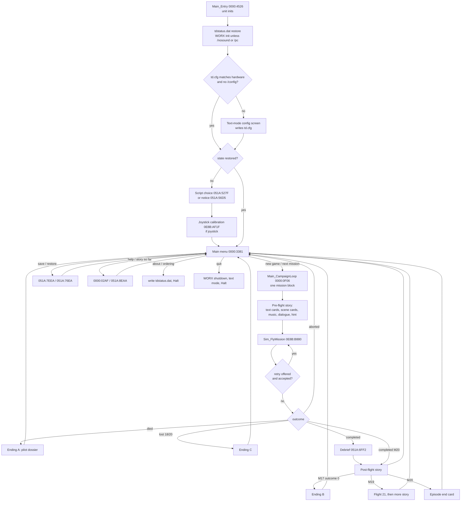

# Episode program flow (`file0001.exe`)

| | |
|---|---|
| **Spec ID** | `flow/episode-program-flow` |
| **Revision** | 5 |
| **Status** | Draft |
| **Fidelity tier** | T2 for the order of screens, scenes, dialogue, music and flights (the player sees it); T1 for the state that flows between missions (mission number, kills, outcome flags); T3 for the text-mode configuration screen and the `tdstatus.dat` hand-off (replaced by the port's own shell) |
| **Confidence** | LIKELY overall (static analysis of the complete sequencer and menu). The mission-1 path is CONFIRMED by capture C-0002 (config → script choice → menu → title card → hangar card → dialogue → hint → flight → retry) |
| **Tasks** | M1-04 (feeds M5-03, M5-07, M8-09, M9-18, M11) |
| **Unknowns** | U-004, U-010, U-026 (answered here for E1), U-038, U-044; U-081 and U-207 resolved (RE-14) |

## 1. Summary

The episode program starts, initialises its units and the WORX sound driver, restores state handed back by the launcher through `tdstatus.dat` (if any), shows the text-mode configuration screen when needed, asks which dialogue script to use, offers joystick calibration, and then runs the **main menu** until the player quits. The menu has nine items. *Start new game* and *Next mission* call `Main_CampaignLoop`, which plays **exactly one mission block** for the current mission number: a scripted sequence of text cards, scene cards, music changes and dialogue scenes, one flight (with a retry loop), the debriefing (none after mission 20), and the post-mission story. Control then returns to the menu, which advances the mission number and the kill total when the mission was completed. After mission 20 the episode ends with a closing text card (`0000:0E51`) and the menu resets. Three game-over endings exist (death, and two mission-specific catastrophes).

All dialogue scene IDs (103 in `dialogue.dat`) are referenced by the sequencer exactly once each; the music index table, scene catalogue and text-card list below are complete for E1.

## 2. Definitions and units

| Term | Meaning |
|---|---|
| Mission number | `g_MissionNumber` DS:0D29 (u8). 0 = no game in progress; 1..20 = next mission to play; 21 is never stored (see §4.4) |
| Kills to date | `g_KillsToDate` DS:0D2A (i16), kills before the current mission |
| Mission kills | `g_MissionKills` DS:12CA (i16), reset at flight start, incremented by the projectile/hit routine `0E8B:0984` |
| Skip flag | `g_SkipStory` DS:1F4E (u8). Cleared at the start of every scene routine, set by the key-wait helpers `051A:1A40`/`051A:1AA3` when the player presses Esc. The sequencer tests it after every scene |
| Text card | `Flow_TextCard` `051A:5852(text, colour = 3Fh, 0, 0)`: a full-screen line of large text (font `td-let.cin`) |
| Scene card | One routine per background (§3.3) taking three ShortString lines (location, sub-location, time); draws the background with `td.lt2` text |
| Dialogue scene | `Flow_DialogueScene` `051A:92AF(id)`: plays scene `id` from `dialogue.dat` (script 1) or `safedial.dat` (script 2), chosen by `g_ScriptChoice` DS:0D28 |
| String reference | `SSSS:OOOO` = address of a ShortString literal in the exe (text is in the exe resource maps, M1-11) |

## 3. Data

### 3.1 Music index (`Snd_PlayMusic`, `0E8B:07ED`)

`Snd_PlayMusic(n)` does nothing unless the music setting `g_CfgMusic` DS:12C6 = 2. Otherwise it stops the current song (`2C37:03BD`), frees its buffer (DS:12D2, size DS:3946), loads the file for `n` (`2C37:0273`) and starts it (`2C37:034B`, handle in DS:12D0). Index 0 is never passed; the sequencer uses `2C37:03BD` directly to stop music.

| n | File | n | File |
|---:|---|---:|---|
| 1 | `td01.cmf` | 8 | `low.cmf` |
| 2 | `td02.cmf` | 9 | `climax.cmf` |
| 3 | `hangar.cmf` | 10 | `mood2.cmf` (unused in E1) |
| 4 | `satair.cmf` | 11 | `moodmaj.cmf` |
| 5 | `vulture.cmf` | 12 | `death.cmf` |
| 6 | `mood.cmf` | 13 | `mood3.cmf` |
| 7 | `menu.cmf` | 14 | `td03.cmf` |

Note the order of 11..13: the table is **not** the order of the file-name list in the exe. In flight, `Sim_FlyMission` picks the song by mission number: `n mod 3 = 1` → 1 (`td01`), `= 2` → 14 (`td03`), `= 0` → 2 (`td02`) (`0E8B:C8FE..C92B`).

### 3.2 Configuration and start-up globals

| Global | Values |
|---|---|
| `g_CfgMusic` DS:12C6 | 1 = off, 2 = on (WORX/AdLib music); 0 forces the configuration screen |
| `g_CfgSfx` DS:12C7 | 1 = off, 2 = Sound Blaster, 3 = PC speaker |
| `g_CfgController` DS:12C8 | 1 = keyboard, 2 = joystick (forced back to 1 when no joystick is detected) |
| `g_NoSoundDriver` DS:13DC | 1 when the first argument is `/nosound`, `/NOSOUND`, `/pc` or `/PC`: WORX is never initialised or called |
| `g_ScriptChoice` DS:0D28 | 1 = original script (`dialogue.dat`), 2 = edited script (`safedial.dat`); forced to 2 when `dialogue.dat` is missing |

Switches (first command-line argument only, exact case variants): `/pc` → music 1, SFX 3; `/nosound` → music 1, SFX 1; `/sb` → music 2, SFX 2; `/a` (`0000:4410`/`0000:4413`) → music 2, SFX 3; `/config` → show the configuration screen. Each switch also sets the controller from joystick detection. `td.cfg` holds the three bytes music, SFX, controller (FORMATS §13.1 confirmed: written at `0000:5044..50A1`).

### 3.3 Scene catalogue (routines called by the sequencer)

| Routine | Background | Arguments | Notes |
|---|---|---|---|
| `051A:1E5A` | `hangar.scr` | 3 strings | |
| `051A:2055` | `vlab.scr` | 3 strings | |
| `051A:22BE` | `intro2.scr` | 3 strings | Also used for the two catastrophe endings |
| `051A:248A` | `shooting.scr` | 3 strings | |
| `051A:3109` | `vhang.scr` | 3 strings | |
| `051A:3371` | `marauder.scr` | 3 strings | |
| `051A:35B0` | `briefing.scr` | 3 strings | |
| `051A:380C` | `tdlab.scr` | 3 strings | |
| `051A:3A6B` | `velsroom.scr` | 3 strings | |
| `051A:3CC0` | `helihang.scr` | 3 strings | 8.3 name of `helihangar.scr` |
| `051A:3E8E` | `eggbase.scr` | 3 strings | |
| `051A:4A66` | `soffice.scr` | 3 strings | |
| `051A:4D66` | `sbar.scr` | 3 strings | |
| `051A:4F5A` | `pic4.td` | 3 strings | |
| `051A:596F` | `voffice.scr` | 3 strings | |
| `051A:471B` | `td1-18.pic` | 3 strings | Story still with text |
| `051A:4113` | `td1-13/14/16/20.pic` | 3 strings + set number (1..4) | Story-still sequence; the number selects which stills |
| `051A:4979` | `td1-15.pic` | none | Plain still at (32, 30), 10 s ([screens](screens.md) §3.9; there is no split-screen or palette effect, U-122) |
| `051A:5852` | text only (`td-let.cin`) | string, colour, 0, 0 | Text card (mission titles and short captions) |
| `051A:2B26` | text only | hint number (1, 2, 6) | Pre-flight hint/tutorial screen; waits for any key or joystick button |
| `051A:62FD` | text only | none | Assignment printout (orders), used before mission 2 |
| `051A:6653` | text only | none | Enemy-ace dossier, used before mission 5 |
| `051A:74B2` | text only | total kills | Pilot dossier, end-game version (status dead) |
| `051A:6A33` | `td.lt2` text | none | Retry prompt; returns true to retry (any key but Esc). Calls `Random(10)` once ([screens](screens.md) §3.7, U-124) |
| `051A:6FF2` | text only | kills, kills to date, outcome flag | Debriefing (§4.5) |

### 3.4 State handed over by flight (`Sim_FlyMission`, `0E8B:B880`)

| Flag | Set by | Meaning |
|---|---|---|
| `g_PlayerDied` DS:12CD | end of `Sim_FlyMission` (`0E8B:F85E`) | 1 when the flight ended because the player's death sequence ran to its end (end-sequence counter DS:32B8 reached 35) |
| `g_MissionAborted` DS:12CE | flight menu `0E8B:794C` | player quit the flight from the Esc menu |
| `g_MissionLost` DS:12CC | `Msn_UpdateEvents` (`0E8B:9860`) in flights 17, 18 and 20 ([mission-logic](../sim/mission-logic.md) §5.17–5.20) | mission failed by objective (missions 17, 18, 20 test it) |
| `g_MissionOutcome` DS:12CF | end of `Sim_FlyMission` | 1 by default; mission-specific test in missions 3, 5, 12, 16 (where particular slots ended) and 17 (= not `g_MissionLost`). Chooses between alternative post-mission dialogue and, in the debrief, between the rating and a "mission failed" note |
| `g_MissionSucceeded` DS:329E | mission logic | ends the flight normally |

## 4. Behaviour

### 4.1 Program start (`Main_Entry` `0000:4526`, body `0000:454E`)

```text
1. unit initialisation chain (System, Crt, 34E6, 2A15, 2404, 1EDE, 0E8B, 051A)
2. g_NoSoundDriver := first argument is /nosound, /NOSOUND, /pc or /PC
3. tdstatus.dat: create it with one 0 byte if missing; if it is longer than 0 bytes and its
   first byte (status) is non-zero, read the saved state (§4.6); then truncate it to 0 bytes
4. unless g_NoSoundDriver: WORX init (2C37:039C), detect card (2C37:0254 -> DS:0502, FFFFh = none),
   install driver (2C37:03F2), open the SFX channel (2C37:01E2 -> DS:12D0)
5. if MaxAvail < 291A0h (168,352 bytes) and the first argument is neither /m nor /M
   (0000:4273/0000:4276): print the memory warning in text mode
   and Halt (not ported)
6. read td.cfg (3 bytes) if present; compare with the detected hardware (card present -> SFX 2 else 3,
   music from 2C37:0219, controller from joystick detection); any difference clears g_CfgMusic
   (forces the configuration screen)
7. apply the command-line switch (§3.2); /config clears g_CfgMusic
8. if g_CfgMusic = 0: text-mode configuration screen (0000:4C5C..50BD): three options + "start",
   keys Up/Down/8/2/Enter/Space/Esc; writes td.cfg
9. if no saved state: dialogue.dat present -> script choice screen 051A:527F (sets g_ScriptChoice);
   absent -> g_ScriptChoice := 2 and notice 051A:56D5. Then flush the BIOS keyboard buffer,
   joystick calibration 0E8B:AF1F when the controller is the joystick, g_MissionNumber := 0
10. main menu 0000:3381 (returns when the player quits)
11. WORX shutdown (2C37:0238, 2C37:0055), text mode 3, Halt
```

### 4.2 Main menu (`Flow_MainMenu` `0000:3381`)

Menu cursor `g_MenuCursor` DS:0754 (0..8; Up/Down wrap; items 1 and 3 are skipped while no game is in progress). Confirmation keys use `UpCase(ReadKey) = 'Y'`. Each action fades the menu out (`0000:0124`) and redraws it afterwards (`0000:2E88`, music 7).

| Item | Action |
|---:|---|
| 0 | Start new game (asks for confirmation if a game is in progress): mission := 1, kills to date := 0, play one mission block (§4.3), then flush the BIOS keyboard buffer (`0000:390A..391D`). If the block completed: mission += 1, kills to date += mission kills, cursor := 3. If the game ended (`g_GameOver` DS:060F): mission := 0 |
| 1 | Save game `051A:7EEA(mission, kills to date, palette)` (only while a game is in progress; [save-screens](save-screens.md)) |
| 2 | Restore game `051A:76EA(palette)` (confirmation if a game is in progress); cursor := 3 when a game is in progress afterwards, even after Esc ([save-screens](save-screens.md)) |
| 3 | Next mission: play one mission block, then flush the BIOS keyboard buffer (`0000:3B97..3BAA`). On completion: mission += 1, kills += mission kills; if mission reaches 21: mission := 0, cursor := 7 (episode finished). On game over: mission := 0, cursor := 0 |
| 4 | Help screens `0000:02AF` (`td.hlp`) |
| 5 | Story so far `051A:8EAA`, then reload `tdmen.pal` |
| 6 | Exit for the "about" program: write `tdstatus.dat` with status 2 and Halt (the launcher runs the extra and restarts the episode, §4.6) |
| 7 | Exit for the "ordering info" program: same with status 1 |
| 8 | Quit to DOS (confirmation) |

`g_MissionAdvance` DS:0610 is set to 1 at the start of every mission block and cleared by the abort path and by every ending; the menu advances only when it is still 1 on return.

### 4.3 One mission block (`Main_CampaignLoop` `0000:0F06`)

```text
g_GameOver := 0; g_MissionAdvance := 1
select the block for g_MissionNumber (tests 1..20 in turn):
  pre-flight story steps; after every step: if g_SkipStory then jump straight to the flight
  repeat
    Sim_FlyMission(flight number)
    retry_offered := g_PlayerDied (+ mission-specific conditions, §4.4)
    if retry_offered and Flow_RetryPrompt() then repeat the flight
  until not retried
  if g_MissionLost (missions 18, 20 only): ending C
  if g_PlayerDied: ending A
  if g_MissionAborted: return (no debrief; g_MissionAdvance := 0)
  unless mission 20: Snd_PlayMusic(8); Flow_Debrief(mission kills, kills to date, g_MissionOutcome)
  post-flight story steps; after every step: if g_SkipStory then return
      (mission 19: before flight 21 a set flag jumps to the flight 21 call instead, §4.4)
return (if g_MissionAborted then g_MissionAdvance := 0)
```

Esc during the pre-flight story skips to the flight; Esc during the post-flight story ends the block (the mission still counts as completed). Not every step is followed by a skip test: the exact list, and why Esc in dialogue 1 still shows hint 1, is in [screens](screens.md) §3.12 (U-125). Layouts of every screen named here: [screens](screens.md); in-flight screens: [flight-screens](flight-screens.md).

### 4.4 Per-mission sequence

Notation: `T[a]` text card with string `0000:a`; `Mn` music n (§3.1); `M0` stop music; `C:bg[a/b/c]` scene card with background bg and strings `0000:a`, `0000:b`, `0000:c`; `Dn` dialogue scene n; `Hn` hint screen n; `O` orders printout; `A` enemy-ace dossier; `Pn[...]` story-still set n; `P15` still `td1-15.pic`; `F n` flight with `Sim_FlyMission(n)`; `R` retry rule; `B` debrief. Retry rule is "retry offered when the player died" unless stated.

| Mission | Pre-flight | Flight | Post-flight (after `M8 B`, except mission 20) |
|---:|---|---|---|
| 1 | T[0478] M3 C:hangar[0494/04A1/04C1] D1 M8 H1 | F 1 | M3 C:hangar[0494/04A1/04D0] D2 M4 C:soffice[04E0/04A1/04F9] D3 |
| 2 | T[050A] M6 C:pic4[052A/0542/0549] D4 O D5 M8 H2 | F 2 | M3 C:hangar[0494/04A1/0552] D6 M4 C:soffice[04E0/04A1/04D0] D7 M5 T[0560] C:voffice[056D/058A/05A4] D8 |
| 3 | T[05A6] M3 C:hangar[0494/04A1/05C0] D11 | F 3 | M3 C:hangar[0494/04A1/0552] then outcome=1 → D13, else D12; M5 T[0560] C:voffice[056D/058A/05A4] D14 |
| 4 | T[05C9] M6 C:briefing[05E3/05FC/05A4] D15 M3 C:hangar[0494/04A1/0607] D16 | F 4 | M3 C:hangar[0494/04A1/04D0] D17 M5 T[0560] C:voffice[056D/058A/0618] D18 |
| 5 | T[0625] M13 C:velsroom[0645/0660/05A4] C:intro2[067A/069C/05A4] C:pic4[06BA/06E0/06FC] A D19 M4 C:soffice[04E0/04A1/04D0] D20 T[070B] D21 M3 C:hangar[0494/04A1/0618] D22 | F 5 | M3 C:hangar[0494/04A1/04D0] then outcome=1 → D156, else D157; M5 T[0560] C:voffice[056D/058A/05A4] D23 |
| 6 | T[0719] M3 C:hangar[0494/04A1/0607] D24 H6 | F 6 | M3 C:hangar[0494/04A1/0733] D25 |
| 7 | T[0740] M5 C:voffice[056D/058A/0759] D26 M4 C:soffice[04E0/04A1/0768] D27 | F 7 | M3 C:hangar[0494/04A1/04D0] D28 M5 T[0560] C:voffice[056D/058A/0776] D29 M13 C:vlab[0787/058A/0549] D100 |
| 8 | T[079A] M6 C:briefing[05E3/0618/05A4] D30 M3 C:hangar[0494/04A1/07B8] D31 | F 8 | M3 C:hangar[0494/04A1/04D0] D32 M4 C:soffice[04E0/04A1/0607] D33 |
| 9 | T[07C5] M4 C:soffice[04E0/04A1/04D0] D34 M3 C:hangar[0494/04A1/04D0] D35 | F 9 | M3 C:hangar[0494/04A1/07E3] D36 M5 T[0560] C:voffice[056D/058A/07B8] D37 |
| 10 | T[07F5] M9 C:eggbase[0810/05A4/05A4] C:voffice[056D/058A/0776] D38 M6 C:briefing[05E3/0844/05A4] D39 | F 10 | M3 C:hangar[0494/04A1/07E3] D40 |
| 11 | T[0856] M5 C:voffice[056D/058A/05C0] D41 M13 C:shooting[0872/0886/05A4] D42 | F 11 | M5 C:voffice[056D/058A/0898] D43 |
| 12 | T[08AB] M4 C:soffice[04E0/04A1/0759] D44 M13 C:pic4[052A/0542/08C7] D45 M13 C:helihang[08D3/08EA/05A4] D46 | F 12 | M6 C:helihang[08D3/08FE/05A4] D47 M6 C:pic4[052A/0542/0549] D48 M11 C:sbar[0913/0549/05A4] D49 M0 T[0938] M4 C:soffice[04E0/04A1/05A4] D50 M9 T[05FC] C:velsroom[094B/05A4/05A4] P3[096F/0989/09A5] C:voffice[056D/058A/04D0] D51 |
| 13 | T[09B2] M5 C:voffice[056D/058A/09D7] D52 M13 C:vhang[09E8/058A/09F7] D53 | F 13 | M13 C:vhang[09E8/058A/0A0C] D54 M5 C:voffice[056D/058A/0898] D55 |
| 14 | T[0A1D] M4 C:soffice[04E0/04A1/05C0] D56 M6 C:vlab[0787/058A/0549] D57 M8 C:intro2[0A39/0A5B/0A74] D58 C:intro2[0A8A/0AB3/0AD0] M13 C:vlab[0787/058A/0AE1] D59 M9 T[09F7] C:voffice[056D/058A/05A4] D60 | F 14 | M4 C:soffice[04E0/04A1/0AF2] D61 M6 C:tdlab[0B08/0B1A/05A4] D108 |
| 15 | T[0B2A] M5 C:voffice[056D/058A/0759] D62 M4 C:soffice[04E0/04A1/0776] D63 M6 C:briefing[05E3/0B49/05A4] D64 M13 C:helihang[0B5A/0898/05A4] D109 | F 15 | M13 C:helihang[0B5A/08FE/05A4] D65 M11 C:sbar[0913/0549/05A4] D66 M9 T[05FC] C:soffice[04E0/04A1/05A4] D67 P4[0B6C/0B88/0BBE] |
| 16 | T[0BC1] M13 C:vlab[0787/058A/05C0] D68 M5 C:voffice[056D/058A/0BDB] D69 M12 P1[0BF5/0C16/05A4] M4 C:soffice[0C45/04A1/0C64] D70 M3 C:hangar[0494/04A1/04F9] D71 | F 16 | M5 C:voffice[056D/058A/0898] then outcome=1 → D72, else D105 |
| 17 | T[0C74] M4 C:soffice[0C45/04A1/0618] D73 M3 C:hangar[0494/04A1/0C91] D74 | F 17; retry offered when died **or outcome = 0** | outcome=0 → M5 C:voffice[056D/058A/0898] D75 then ending B; outcome=1 → M11 C:sbar[0913/0549/05A4] D76 M5 C:voffice[056D/058A/0898] D77 |
| 18 | T[0CA5] M5 C:voffice[056D/058A/0898] D78 M3 C:hangar[0494/04A1/0CBF] D80 M4 C:soffice[0C45/04A1/0607] D81 | F 18; retry offered when died **or lost**; declined while lost → ending C | M3 C:hangar[0494/04A1/07E3] D82 M5 T[0560] C:voffice[056D/058A/05A4] D83 P15 D84 M13 C:vlab[0560/0CCD/05A4] C:td1-18[0CE7/0CFC/05A4] |
| 19 | T[0D27] M6 C:briefing[05E3/0D47/05A4] D85 M4 C:soffice[0C45/04A1/0898] D86 M3 C:hangar[0494/04A1/0AF2] D87 | F 19 | M5 C:voffice[056D/058A/0898] D88 M3 C:hangar[0494/04A1/07E3] D89, **then F 21** (no retry, no debrief; a set skip flag after C:voffice, D88 or C:hangar jumps straight to F 21; after F 21 only the abort flag is tested: abort → return, mission not advanced), then M13 T[0D54] C:tdlab[0D69/0D89/05A4] D91 M5 T[0560] C:marauder[0D98/0DB0/0DC7] D90 |
| 20 | T[0DD3] M4 C:soffice[0C45/04A1/0DED] D92 M11 C:sbar[0913/0549/05A4] D93 M4 C:soffice[0C45/04A1/0DFE] D110 M13 C:tdlab[0E10/0E20/05A4] D94 M3 C:hangar[0494/04A1/05C0] D95 | F 20; as mission 18 | **no `M8 B`**: straight to M13 C:tdlab[0E10/0552/05A4] D96 M4 C:soffice[0C45/04A1/04D0] D97 M6 C:tdlab[0E10/0549/05A4] D98 M9 C:velsroom[0E37/07B8/05A4] D99 P2[05A4/05A4/05A4] T[0E51] (episode end card) |

In mission 10 the two scene cards follow each other without a skip test between them. In mission 19 the scene `C:soffice[0C45/04A1/0898]` is followed by D86 without a skip test. String `0000:05A4` is a single space (a blank line).

**Flight 21** is a scripted flight without a mission file (`m21.td` does not exist in E1; `Sim_FlyMission` skips the file load for 21 and loads the helicopter sprites, §4.3 of [tick-order](../sim/tick-order.md)). It ends itself after 25 ticks (`0E8B:CC9A`) through the end sequence ([mission-logic](../sim/mission-logic.md) §5.21), so it always returns with `g_PlayerDied` = 1. The mission-19 block tests only `g_MissionAborted` after it (`0000:2AA4`): died is ignored, there is no retry prompt, no `M8` and no debrief, and an abort from the Esc menu ends the block with `g_MissionAdvance` := 0 (`0000:2E69`), so mission 19 is played again from its start next time. Its flight song is `td02` ([music-cues](../audio/music-cues.md) §4). What the flight shows on screen is U-044 (P3). U-081.

**Mission 20 has no debrief** (`0000:2C87..2CA5`): after flight 20 the block tests lost (ending C), died (ending A) and aborted (return), then plays music 13 and the first post-flight scene. There is no `Snd_PlayMusic(8)` and no `Flow_Debrief` call. The mission's kills still count (the menu adds them when the block returns with `g_MissionAdvance` = 1). U-207.

### 4.5 Endings and debrief

| Ending | Trigger | Steps | Result |
|---|---|---|---|
| A, death | `g_PlayerDied` after the retry was declined (any mission) | M12, WORX `2C37:0378(0)`, pilot dossier `051A:74B2(kills to date + mission kills)`, `2C37:0378(1)` | `g_GameOver` := 1, `g_MissionAdvance` := 0 |
| B, mission 17 failure | mission 17 completed with outcome 0 | after D75: M12, `2C37:0378(0)`, C:intro2[0E6B/0E9B/0EC3], `2C37:0378(1)` | game over |
| C, missions 18/20 lost | `g_MissionLost` after the retry was declined | M12, `2C37:0378(0)`, C:intro2[0ED4/0E9B/0EC3], `2C37:0378(1)` | game over |
| Episode end | mission 20 post-flight completes | P2 stills, text card `0000:0E51` | menu: mission 21 → 0, cursor to item 7 |

Debrief `Flow_Debrief` `051A:6FF2(kills, kills_to_date, outcome)` shows the mission kills and the total `T = kills_to_date + kills`. If `outcome = 0` it shows a "mission failed" note instead of a rating. Otherwise the rating is the **last** matching tier of: T < 0 → cheater; T ≥ 0 → tier 1; T > 9 → 2; > 19 → 3; > 39 → 4; > 59 → 5; > 79 → 6; > 109 → 7; > 149 → 8; > 174 → 9; > 199 → 10; > 299 → 11; > 29999 → cheater (string `051A:6CE7` for both cheater cases; tier strings `051A:6D17`..`6F7E`). It then waits for a key (`051A:1AA3(10)`). **U-010:** the cheater rating appears only for impossible totals (negative or above 29,999), which a normal game cannot reach; it has no other consequence in the debrief. (The hostile `label.exe` calls are elsewhere, in flight: [globals](../../re/globals.md) §5.)

### 4.6 `tdstatus.dat` hand-off (U-004, file0001 side)

14 bytes, written by menu items 6 and 7 just before `Halt`, read at the next start:

| Offset | Size | Field |
|---:|---:|---|
| 0 | 1 | status: 0 = none, 1 = returned from "ordering info", 2 = returned from "about" |
| 1 | 2 | kills to date (DS:0D2A) |
| 3 | 1 | mission number (DS:0D29) |
| 4 | 1 | menu cursor (DS:0754) |
| 5 | 8 | joystick calibration words DS:1F5C, DS:1F5A, DS:1F58, DS:1F56 |
| 13 | 1 | script choice (DS:0D28) |

When the status is non-zero the program skips the script choice and joystick calibration and goes straight to the menu with the restored cursor and game. The file is truncated to 0 bytes on every start. The launcher runs `order.exe` for status 1 and `aboutus.exe` for status 2 (with `intro.cmf` playing), then this program again with the same first parameter ([launcher](launcher.md) §4.4; C-0049, C-0050).

### 4.7 Diagram



## 5. Edge cases and original bugs

| Quirk | Original behaviour | Port policy (proposal) |
|---|---|---|
| Esc in the post-flight story | Ends the block but the mission still counts as completed | Preserve |
| Aborting a flight from the Esc menu | No debrief, mission not advanced, kills of that attempt discarded | Preserve |
| Kills of failed attempts | `g_MissionKills` is reset at every flight start, so only the last attempt counts | Preserve |
| Episode completion | Mission number wraps to 0 and the menu cursor jumps to "ordering info" | Classic: return to the menu; the cursor jump is advertising (decision for the user, D4-related) |
| Cheater rating | Only reachable with tampered totals | Preserve text only (D9) |
| Mission 21 | Played only from the mission-19 block | Preserve |

## 6. Test vectors

| # | Setup / input | Expected | Evidence |
|---|---|---|---|
| 1 | New install, no switches: config screen → "start" → script 1 → menu → Enter | Text card `0000:0478`, hangar card, dialogue 1, hint 1, flight 1 | C-0002 (`int21.tsv` opens: `td-let.cin`, `hangar.scr`, `dialogue.dat`/`newfaces.td`, flight files) |
| 2 | Flight 1 with no input | Player destroyed after about 33 s, retry prompt shown (`051A:6A33`) | C-0002 scenario notes |
| 3 | Debrief tiers | T = 0 → tier 1; 10 → 2; 20 → 3; 40 → 4; 300 → 11; 30000 → cheater; −1 → cheater | static (`051A:6FF2`) |
| 4 | Music index | `Snd_PlayMusic(12)` opens `death.cmf`; 13 opens `mood3.cmf` | static (`0E8B:07ED`) |

## 7. Presentation and audio hooks

Music cues are the `Mn` entries in §4.4; the flight picks its own song (§3.1). Scene and text cards fade with retrace-paced palette loops (timing §4.4). The debrief and dossiers use `Crt.Delay(500)` between lines.

## 8. Open questions

- [x] Q1: answered in [screens](screens.md) §2.2 (U-123).
- [ ] Q2 (U-038): the WORX calls `2C37:0378(0/1)` around the endings (pause/resume sound effects?).
- [x] Q3 (M1-10): answered in [launcher](launcher.md) §4.4: status 1 → `order.exe`, 2 → `aboutus.exe`; the launcher passes its first parameter to every run of this program.
- [ ] Q4 (U-044): what flight 21 shows.

## 9. Provenance

| Claim | Address / capture | Method | Confidence |
|---|---|---|---|
| Start-up order, switches, td.cfg, tdstatus.dat read/write | `file0001:0000:454E..519F`, `0000:3C2E..3E9A` | static | LIKELY (layout CONFIRMED by the paired write/read sequences) |
| Menu items and actions | `0000:3381..424B`; menu image C-0002 `main-menu` frame | static + capture | LIKELY |
| One mission block per call; per-mission sequence | `0000:0F06..2E76` | static (complete token walk) | LIKELY |
| Dialogue IDs: all 103 scene IDs of `dialogue.dat` used once | `0000:0F06` vs file scan | static + decode | CONFIRMED |
| Music index table | `0E8B:07ED..0981` | static | CONFIRMED |
| Flight song by mission mod 3 | `0E8B:C8F0..C930` | static | LIKELY |
| Outcome flags | `0E8B:F826..F990` | static | LIKELY |
| Debrief thresholds | `051A:6FF2` | static | LIKELY |
| Mission-1 path | C-0002 | capture | CONFIRMED |

## 10. Revision history

| Rev | Date | Author (session/agent) | Change |
|---|---|---|---|
| 1 | 2026-11-02 | RE-2 (Archaeologist + Spec author) | Initial: start-up, menu, complete E1 mission sequence, endings, debrief tiers, tdstatus.dat |
| 2 | 2026-11-02 | RE-8 | `td1-15.pic` is a plain still (U-122); retry prompt calls `Random` (U-124); skip tests per step in [screens](screens.md) §3.12 (U-125); Q1 answered (U-123) |
| 3 | 2026-11-05 | RE-10 (Spec author, U-252) | §4.2: items 0 and 3 flush the BIOS keyboard buffer after `Main_CampaignLoop` returns (`0000:390A..391D`, `3B97..3BAA`; keys typed during the block do not reach the menu) |
| 4 | 2026-11-05 | RE-13 | §4.6 and Q3: which extra the launcher runs per status ([launcher](launcher.md)); no behaviour change |
| 5 | 2026-11-06 | RE-14 (Archaeologist + Spec author) | U-207: mission 20 has no `M8` and no debrief (`0000:2C87..2CA5`). U-081: flight 21 outcome handling (only abort tested, died ignored, abort → mission not advanced); in mission 19 the skip tests before flight 21 jump to flight 21, not to the block end (`0000:2A45..2A9D`) |
